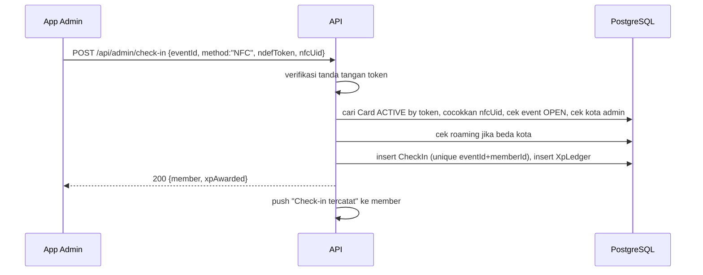
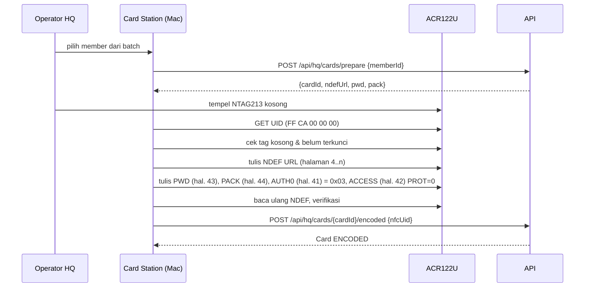

# PATS University — Build Plan (Showcase Prototype)

Versi: 1.0 — 16 Oktober 2026. Mengacu ke [PRODUCT.md](PRODUCT.md).

Tujuan plan ini: membangun prototype yang bisa didemokan end-to-end sesuai visi penuh PRD, dalam lima fase, masing-masing berakhir dengan sesuatu yang bisa diperlihatkan.

## Fokus: sistem absensi berbasis kartu lebih dulu

Keputusan owner 16 Oktober 2026: **Phase 0–2 harus menghasilkan sistem absensi kartu yang jalan end-to-end** sebelum fitur lain disentuh:

1. Registrasi web → NIM → akun.
2. Kartu NFC: Card Station di Mac (tulis NDEF, kunci, bind UID) → cetak → kirim → konfirmasi serah terima oleh admin lokal.
3. Kartu digital (QR berputar) sebagai fallback.
4. Scan admin (NFC / QR app / manual) + check-in + riwayat kehadiran.
5. Dasar super admin: kota, admin, member, event, card batch, settings.

XP/leaderboard/reward, laporan PR, social hub, reservasi, dan roaming **menyusul** di Phase 3–4. Tidak ada pekerjaan fase lanjut yang dimulai sebelum demo Phase 2 lolos.

---

## 1. Stack (final)

> Stack ini **final** (keputusan owner 16 Oktober 2026). Perubahan setelah ini berarti mengulang fase yang terdampak.

| Lapisan | Pilihan | Alasan |
|---|---|---|
| Mobile app (member + local admin) | **Expo (React Native)**, TypeScript, Expo Router | Satu codebase iOS + Android; EAS Build untuk TestFlight/APK; ekosistem NFC/kamera/push matang |
| NFC (app admin) | `react-native-nfc-manager` | Core NFC (iOS) + NFC Android dalam satu API; membaca NDEF URL + UID dalam satu sesi tap |
| Card Station (Mac HQ) | **Rust** dengan crate **`pcsc`** (PC/SC), reader **ACR122U**, kartu **NTAG213** | PC/SC bawaan macOS; `pcsc` memberi akses APDU langsung untuk tulis NDEF + kunci PWD/PACK; binary tunggal tanpa runtime, mudah dijalankan operator HQ. HTTP ke API lewat `reqwest`, CLI lewat `clap` |
| Kamera / QR | `expo-camera` (barcode scanning bawaan) | Tanpa native module tambahan |
| Push | `expo-notifications` → APNs / FCM | Satu token Expo, server kirim via Expo Push API |
| Peta / denah venue | Komponen denah sendiri (SVG/grid) + `react-native-maps` untuk lokasi venue | Denah sofa/table bukan peta geografis; grid sederhana cukup untuk demo |
| Anti-screenshot | `expo-screen-capture` | `FLAG_SECURE` Android; deteksi di iOS |
| Backend + super admin dashboard | **Next.js (App Router) + Prisma + PostgreSQL** | Pola yang sama dengan NEXUS milik owner; satu deploy untuk API + dashboard |
| Leaderboard | Query agregat `XpLedger` + snapshot per jam | Tanpa layanan tambahan |
| Auth | **Nomor HP + OTP** buatan sendiri (tabel `OtpCode`), JWT access + refresh token. Pengirim OTP pluggable lewat `OTP_PROVIDER` = `demo` (OTP di layar) / `whatsapp-bridge` (Baileys, tidak resmi) / `cloud-api` (WhatsApp Cloud API resmi + SMS fallback) — lihat PRODUCT.md §10.6 | Tanpa vendor untuk showcase; jalur produksi tinggal ganti provider |
| Realtime chat | **Socket.IO** (server terpisah kecil di repo yang sama) | Lihat §1.1 |
| File / media | **S3-compatible object storage** (MinIO di VM, atau bucket S3) | Presigned upload dari app; URL privat |
| Job terjadwal | Cron di server (endpoint `/api/cron/*` dipanggil systemd timer) | Reminder H-3/H-1/H, follow-up 12.00, expiry roaming/redeem |
| Export | CSV/XLSX via `exceljs`; PDF = print view | Cukup untuk demo |
| Hosting | Infrastruktur VM owner yang sudah ada (Docker Compose, reverse proxy, TLS), domain **`patsuniv.znetworks.id`** | Tidak butuh layanan baru; DNS + tunnel dipasang sesi server utama di akhir Phase 0 |

### 1.1 Realtime: Socket.IO vs Supabase Realtime

Dipilih **Socket.IO**:

- Stack sudah Prisma + PostgreSQL biasa, bukan Supabase; menambah Supabase hanya untuk realtime berarti dua sumber kebenaran untuk auth dan row-level security.
- Chat PATS butuh logika server (mention `@ADMIN` → push ke admin, region lock, roaming expiry) yang lebih mudah ditulis di handler Socket.IO daripada di policy Postgres.
- Pola ini sudah dipakai owner di NEXUS (room per workspace), sehingga risiko dan operasionalnya dikenal.
- Supabase Realtime lebih cocok jika kelak ingin menghapus server chat sendiri; tercatat sebagai alternatif.

---

## 2. Arsitektur

```mermaid
flowchart TB
  subgraph Clients
    M[App Member/Admin\nExpo RN iOS+Android]
    W[Web Registrasi\npublic]
    H[Super Admin Dashboard\nweb]
    CS[Card Station\nMac + ACR122U]
  end

  subgraph Server["apps/web (Next.js)"]
    API[REST API /api/*]
    DASH[Dashboard pages]
    CRON[/api/cron/*]
  end

  RT[Socket.IO server\napps/realtime]
  DB[(PostgreSQL)]
  OBJ[(Object storage\nS3-compatible)]
  PUSH[Expo Push → APNs / FCM]
  TIMER[systemd timer]

  M -->|HTTPS JWT| API
  M -->|WSS JWT| RT
  W --> API
  H --> DASH
  CS -->|HTTPS token super admin| API
  DASH --> API
  API --> DB
  RT --> DB
  API -->|presigned URL| OBJ
  M -->|upload/download| OBJ
  API --> PUSH
  CRON --> PUSH
  TIMER --> CRON
  API -->|publish event| RT
```

Prinsip:

- **Server adalah sumber kebenaran** untuk check-in, XP, redeem, spin, roaming expiry. App tidak pernah menghitung sendiri.
- **Satu API** untuk app dan dashboard; dashboard memakai server component + route handler yang sama.
- **Role & kota dicek per endpoint** (middleware `requireRole`, `requireCityAccess`).
- **Realtime** hanya untuk chat, timeline, dan feed kehadiran live di layar admin; selain itu REST.

### 2.1 Alur scan (Phase 1–2)



Untuk `APP_QR`: app member minta `GET /api/me/card-token` tiap 30–60 detik (token HMAC `{memberId, nonce, exp}`); admin memindai, mengirim `{method:"APP_QR", token}`; server memverifikasi tanda tangan, exp, dan nonce sekali pakai (tabel `UsedNonce` atau cache).

### 2.2 Alur encode kartu (Card Station, Phase 2)



Catatan teknis:

- Perintah ke NTAG213 lewat ACR122U memakai APDU pass-through `FF 00 00 00 Lc <perintah ISO14443-3A>`; `READ` = `30 <page>`, `WRITE` = `A2 <page> <4 byte>`, `PWD_AUTH` = `1B <4 byte pwd>`.
- NDEF URL dengan prefix `https://` memakai URI identifier code `0x04`, dibungkus TLV `03 <len> ... FE` mulai halaman 4. Kapasitas user NTAG213 = 144 byte, cukup untuk `https://patsuniv.znetworks.id/c/<token 32 char>` (±60 byte payload).
- **Domain final `patsuniv.znetworks.id`** dan URL `/c/<token>` **permanen**: tertulis di tag yang dikunci, jadi subdomain ini harus dipertahankan selamanya (redirect bila kelak pindah domain). Lihat PRODUCT.md §10.7.
- `AUTH0 = 0x03` berarti halaman 3 ke atas butuh autentikasi untuk **tulis** (`PROT = 0` = hanya tulis yang diproteksi; baca tetap bebas agar HP member bisa membaca NDEF). `AUTHLIM` diset 0 (tanpa batas percobaan) untuk menghindari kartu terkunci permanen akibat salah proses.
- PWD per kartu diturunkan server dari kunci rahasia + UID (HMAC, 4 byte) sehingga HQ bisa menghitung ulang untuk re-encode; tidak disimpan di DB.
- Bit `Capability Container` dan `static lock` **tidak** disentuh, supaya kartu salah encode masih bisa diperbaiki dengan PWD.

---

## 3. Struktur repo (monorepo)

```
pats-univ/
├── apps/
│   ├── mobile/            # Expo RN: member + local admin (role-based)
│   │   ├── app/           # Expo Router: (auth), (member), (admin)
│   │   ├── src/
│   │   │   ├── api/       # client API (generated types dari packages/shared)
│   │   │   ├── features/  # card, checkin, events, rewards, hub, reservation, roaming
│   │   │   ├── components/
│   │   │   └── i18n/      # en.json, id.json
│   │   └── app.config.ts
│   ├── web/               # Next.js: API + registrasi public + super admin dashboard
│   │   ├── app/
│   │   │   ├── (public)/join/      # web registrasi
│   │   │   ├── (admin)/            # dashboard HQ
│   │   │   └── api/                # route handlers
│   │   ├── prisma/schema.prisma
│   │   └── src/lib/       # auth, xp, checkin, nim, push, export
│   └── realtime/          # Socket.IO server (chat, timeline, live attendance)
├── packages/
│   ├── shared/            # tipe, enum, validator (zod), konstanta, format angka/tanggal
│   └── ui-tokens/         # warna, spasi, tipografi dipakai mobile & web
├── tools/
│   └── card-station/      # Mac + ACR122U: encode NTAG213 (Rust, crate pcsc)
│       ├── Cargo.toml
│       ├── src/
│       │   ├── main.rs    # CLI: login, pilih batch, loop encode, re-encode, verify
│       │   ├── ntag213.rs # APDU: read/write/pwd_auth, NDEF encode, lock
│       │   └── api.rs     # klien API (prepare, encoded)
│       └── README.md      # setup PC/SC + ACR122U di macOS
├── docs/
│   ├── PRODUCT.md
│   ├── PLAN.md
│   └── STATUS.md          # progres per fase (diisi saat build)
├── infra/
│   ├── docker-compose.yml # web, realtime, postgres, minio
│   └── deploy.sh
├── package.json           # pnpm workspaces
└── README.md
```

Alasan monorepo: tipe dan validator dibagi (`packages/shared`) agar app, dashboard, dan server tidak saling meleset; satu PR bisa mencakup server + web + mobile untuk satu fitur (aturan paritas).

---

## 4. Fase

Setiap fase diakhiri **demo yang bisa diperlihatkan** dan `docs/STATUS.md` diperbarui. Estimasi dalam hari kerja satu engineer penuh waktu; QA interaksi masuk ke dalam estimasi.

### Phase 0 — Skeleton, auth, registrasi web

**Isi**

- Monorepo, Docker Compose (postgres, minio, web, realtime kosong), CI lint + typecheck.
- Schema Prisma lengkap untuk seluruh entitas §7 PRODUCT.md (migrasi awal), seed: 3 kota, 1 super admin, 2 local admin, 20 member, 2 venue, 3 event.
- Auth: **nomor HP + OTP**, JWT access/refresh, role dari `User`; middleware role & kota. Modul `OtpSender` dengan provider dipilih lewat env `OTP_PROVIDER`; Phase 0 cukup `demo` (OTP tampil di layar / respons API). Provider `whatsapp-bridge` (Baileys, nomor khusus, rate limit, fallback layar) menyusul saat uji HP sungguhan; `cloud-api` untuk produksi (PRODUCT.md §10.6).
- **Web registrasi** `/join`: form (nama, DOB, kota, song & genre, quotes, **nomor HP/WA wajib**, email opsional), verifikasi nomor lewat OTP, cek `minAge`, generate NIM, halaman sukses dengan link grup WA + link download app, pesan konfirmasi ke nomor HP lewat OTP provider (email bila diisi).
- **Akhir Phase 0**: DNS `patsuniv.znetworks.id` + tunnel ke VM dipasang oleh sesi server utama owner (di luar estimasi engineer); sejak itu `/join` dan dashboard tersaji di domain final.
- Dashboard HQ: login, layout, halaman Kota, Admin, Member (list + detail), Settings (semua key §9).
- App: shell Expo, login OTP, routing berdasarkan role, i18n EN/ID, tab bar member dan menu admin kosong.

**Demo**: scan QR → daftar di web dengan nomor HP (OTP tampil di layar, mode `demo`) → NIM muncul → login di app dengan nomor itu → profil tampil; HQ melihat member baru di dashboard dan mengubah `minAge`.

**Effort**: 6–8 hari.

### Phase 1 — Kartu digital, scan admin, check-in

**Isi**

- Kartu digital di app: tampilan KTM + QR berputar (token HMAC, TTL dari setting), status kartu fisik.
- Event: list & detail di app (kota asal), CRUD di dashboard dan di menu admin app; status `OPEN`/`CLOSED` + jendela check-in.
- Mode **Scan** admin: kamera QR (`APP_QR`) dan manual (cari nama + alasan). Layar hasil: nama, foto, NIM, konfirmasi.
- `POST /api/admin/check-in` dengan validasi §6.1 PRODUCT.md, unik per event, metode tercatat. Entri `XpLedger` sudah ditulis di sini (angka dari setting) tetapi **tidak ditampilkan** sampai Phase 3.
- Riwayat kehadiran di app (member) dan daftar kehadiran per event di app admin + dashboard. Feed kehadiran live di layar admin (REST polling dulu; realtime di Phase 4).
- `AuditLog` untuk manual check-in.

**Demo**: admin membuka event, member menunjukkan QR app, admin scan → check-in tercatat, riwayat muncul di app member, daftar hadir muncul di dashboard; scan kedua ditolak; screenshot QR lama ditolak setelah TTL; manual check-in wajib alasan dan tercatat di audit.

**Effort**: 6–8 hari.

### Phase 2 — Kartu NFC, card batch, push

**Isi**

- **Card Station** (`tools/card-station`, Rust + `pcsc`, Mac + ACR122U): login super admin → pilih batch → per kartu: tempel NTAG213 kosong → baca UID → tulis NDEF URL `https://patsuniv.znetworks.id/c/<token>` → set PWD/PACK + AUTH0 (kunci tulis) → verifikasi baca ulang → lapor `ENCODED` ke server. Mode re-encode untuk kartu salah/pengganti (PWD dihitung ulang dari UID). Lihat §2.2.
- Endpoint `/api/hq/cards/prepare` dan `/api/hq/cards/{id}/encoded`; `/c/<token>` di web: jika app terpasang → universal link ke profil, jika tidak → halaman profil ringkas + link download.
- NFC di app admin (`react-native-nfc-manager`): baca NDEF + UID dalam satu sesi; alur **Serah terima kartu** (tap → server cocokkan token+UID → `ACTIVE`, tanpa pilih member), **Lapor hilang** (`REVOKED`).
- `CheckIn` metode `NFC` dengan verifikasi token + UID; urutan fallback NFC → APP_QR → MANUAL tampil di UI admin.
- Deep link `/c/<token>` di app member (universal link iOS + app link Android; AASA `/.well-known/apple-app-site-association` dan `/.well-known/assetlinks.json` disajikan dari `patsuniv.znetworks.id`): tap kartu sendiri di iPhone XS+ membuka profil.
- Dashboard HQ: **Card batch** (pilih member `NOT_PRINTED` per kota → batch → progres encode → export CSV/XLSX file cetak dengan URL QR per kartu → `PRINTED` → `SHIPPED`), daftar kartu belum `ACTIVE`.
- Push: registrasi device, Expo Push, pusat notifikasi, pengaturan kategori; cron reminder H-3/H-1/H dan follow-up 12.00 (terima kasih / FOMO); copy per kota dari `City.notificationCopy`; broadcast event dari dashboard (flyer + push).
- Audit metode check-in di dashboard (persentase NFC / APP_QR / MANUAL per event).

**Demo**: HQ membuat batch; di Mac, Card Station meng-encode kartu NTAG213 (tulis + kunci) → status `ENCODED`; mencoba menulis ulang kartu dengan app NFC umum → gagal; HQ ekspor file cetak; admin menerima kartu, tap saat serah terima → `ACTIVE`; di event, tap kartu → check-in `NFC`; kartu dilaporkan hilang → revoke, token+UID lama ditolak; member tap kartunya sendiri di iPhone → profil terbuka; push reminder dan FOMO sampai ke HP demo.

**Effort**: 9–11 hari (termasuk Card Station ±2–3 hari). Hardware sudah ada: NTAG213 PVC + ACR122U; perlu iPhone + Android fisik untuk uji.

**Gerbang**: demo Phase 2 harus lolos end-to-end (registrasi → encode → serah terima → check-in NFC → riwayat → dashboard) sebelum Phase 3 dimulai.

### Phase 3 — XP, leaderboard, reward, spin wheel, laporan PR, recap & export

**Isi**

- XP tampil di app: saldo, ledger, milestone; setting `xpPerCheckIn` dari dashboard (entri ledger sudah ada sejak Phase 1).
- Leaderboard kota & nasional: query agregat per periode + `LeaderboardSnapshot` per jam (cron), tie-break sesuai §6.6 PRODUCT.md, posisi sendiri selalu tampil; halaman leaderboard di dashboard.
- Katalog reward di dashboard (setting XP, stok, kota), tampilan di app.
- **Laporan PR**: flag `isPromoter` (diberi dari dashboard/app admin — mekanisme final TBD), menu PR di app: form tamu + unggah foto struk ke bucket privat (presigned URL, akses bertanda tangan berumur pendek), daftar laporan di app admin dengan validasi/tolak, bonus dikreditkan sesuai `promoterBonusKind` (XP → `XpLedger`; CASH → `PromoterPayout`), laporan + struk di recap dashboard dan export.
- Direct redeem: `Redemption` dengan kode 6 karakter + QR, TTL, refund otomatis saat kedaluwarsa.
- Validasi crew: scan/masukkan kode → `FULFILLED`; penolakan untuk kode terpakai/kedaluwarsa.
- Spin wheel: hasil server dengan bobot, batas spin per event, animasi di app, hadiah masuk sebagai `Redemption` tipe `SPIN`.
- Traffic recap: form admin per event (sofa, table, FDC, pax, revenue), total otomatis, kunci oleh HQ.
- Dashboard HQ: recap global, filter, export 1-klik (CSV/XLSX) untuk member, check-in, XP, redemption, recap. Dashboard kota untuk admin di app.

**Demo**: XP dari check-in Phase 1–2 muncul di app; leaderboard Jakarta dan nasional menampilkan peringkat, member melihat posisinya; member menukar XP → kode muncul → crew validasi → kode kedua kali ditolak; member spin 5 kali, spin keenam ditolak; PR mengirim laporan 12 tamu + foto struk → admin validasi → bonus masuk → laporan dan struk tampil di recap HQ (struk hanya bisa dibuka admin); admin mengisi recap → HQ export XLSX dengan angka format `3.800` / `Rp 6.000.000`.

**Effort**: 10–12 hari.

### Phase 4 — Social hub, reservasi, roaming

**Isi**

- Socket.IO server: auth JWT, room per channel kota, pesan teks, voice note & video pendek (presigned upload ke object storage), mention `@ADMIN` → push ke admin kota, riwayat 30 hari.
- Timeline per kota: post foto/teks, pin, hapus, mute (moderasi admin). Channel management di app admin dan di dashboard.
- Anti-screenshot: `FLAG_SECURE` di layar hub Android; deteksi di iOS → catat `ScreenshotEvent` + peringatan.
- Reservasi venue: editor denah sederhana di dashboard (grid slot sofa/table), pemilihan slot di app, `Conversation` reservasi member ↔ admin, konfirmasi/tolak, unik per slot per event.
- Roaming: request `ATTENDANCE` (approve Local Admin tujuan) dan `SOCIAL_HUB` (approve HQ), push ke approver dan pemohon, `accessExpiresAt` = endsAt + 48 jam, cron expiry, check-in roaming di scan admin.
- Feed kehadiran live di layar admin dipindah ke Socket.IO.

**Demo**: member Jakarta chat di hub Jakarta dengan voice note; mention `@ADMIN` → admin dapat push; member Bandung minta roaming ke event Jakarta → admin Jakarta approve absensi, HQ approve hub → member Bandung melihat hub Jakarta; 48 jam disimulasikan dengan mengubah setting → akses hilang; reservasi sofa dikonfirmasi admin; screenshot hub di Android gagal, di iOS tercatat.

**Effort**: 10–12 hari.

### Ringkasan effort

| Fase | Hari kerja | Kumulatif |
|---|---|---|
| 0 | 6–8 | 6–8 |
| 1 | 6–8 | 12–16 |
| 2 | 9–11 | 21–27 |
| **Gerbang: absensi kartu end-to-end** | | **±4–5 minggu** |
| 3 | 10–12 | 31–39 |
| 4 | 10–12 | 41–51 |
| Buffer QA + polish + demo prep | 5 | 46–56 |

Perkiraan total **9–12 minggu** satu engineer; dua engineer (mobile + server) memangkas ke **6–8 minggu** karena Phase 1–4 bisa paralel setelah schema dikunci di Phase 0. Sistem absensi kartu (Phase 0–2) siap didemokan dalam **±4–5 minggu** satu engineer.

---

## 5. Risiko

| Risiko | Dampak | Mitigasi |
|---|---|---|
| Core NFC iOS hanya membaca saat sesi aktif dan butuh entitlement; perilaku beda per model iPhone | Bind/scan tidak jalan di demo | Uji di device fisik sejak awal Phase 2; fallback APP_QR selalu tersedia |
| Cetak per orang di PVC belum diputuskan (printer in-house vs vendor) | Kartu ter-encode tapi belum bisa dibagikan | Encode dulu, cetak menyusul; untuk demo cukup label/stiker; keputusan T8 sebelum Phase 2 selesai |
| ACR122U di macOS: driver PC/SC bawaan kadang bentrok dengan `ifdhandler` ACS; reader mode "escape" perlu plist | Card Station tidak melihat reader | Dokumentasi setup di `tools/card-station/README.md`; uji di Mac HQ sejak awal Phase 2 |
| Salah urutan kunci NTAG213 (AUTH0/PWD) bisa mengunci kartu permanen | Kartu terbuang | Verifikasi tulis sebelum set AUTH0; AUTHLIM = 0; jangan sentuh static lock; uji di 5 kartu pertama |
| Token + UID masih bisa diemulasi dengan magic card | Check-in palsu | Diterima (admin melihat orangnya); jalur upgrade ke NTAG 424 DNA (SUN) |
| QR app discreenshot | Check-in palsu | TTL 30–60 detik + nonce sekali pakai |
| Push tidak sampai (APNs key, FCM config, token kadaluarsa) | Reminder & FOMO gagal | Checklist konfigurasi EAS; log pengiriman per `Notification`; retry |
| OTP provider `whatsapp-bridge` tidak resmi (Baileys): nomor bisa diblokir Meta, sesi bisa putus (terjadi di setup Hermes owner, Jul 2026) | OTP tidak sampai, login macet | Nomor WA khusus; rate limit; fallback OTP di layar selalu aktif; hanya untuk uji internal; produksi pakai Cloud API resmi + SMS, verifikasi Meta Business dimulai sejak awal (T17) |
| Chat realtime pada demo depth | Lag/putus saat demo | Satu channel per kota, batas media, reconnect otomatis di client |
| Anti-screenshot iOS tidak bisa dipaksa | Ekspektasi tim berbeda | Ditulis eksplisit di PRODUCT.md §10.4; tampilkan deteksi di demo |
| XP/reward/bonus PR/periode leaderboard berubah setelah coding | Rework | Semua angka sebagai setting; UI membaca setting, tidak hardcode; bonus PR disiapkan dua jalur (XP dan CASH) |
| Foto struk bocor | Data finansial terbuka | Bucket privat, URL bertanda tangan berumur pendek, cek role di server, tidak pernah masuk CDN publik |
| Zona waktu | Reminder salah jam | Simpan UTC, hitung jadwal per `City.timezone`, tes dengan kota di luar WIB |
| Review App Store untuk NFC & konten komunitas | Rilis TestFlight tertahan | Demo lewat TestFlight internal + APK; siapkan deskripsi penggunaan NFC/kamera |
| Data pribadi member | Kebocoran | Export hanya HQ + audit; URL media privat; DOB tidak pernah dikirim ke app lain selain pemilik |

---

## 6. Aturan repo (berlaku di semua repo owner)

1. **Commit atas nama Berlin** (`user.name=Berlin`, `user.email=bagasputro.bp@gmail.com`). Tidak ada `Co-Authored-By`, tidak ada penyebutan alat bantu apa pun di commit, kode, komentar, maupun dokumen.
2. **Branch**: `master` = rilis, `dev` = integrasi, branch fitur pendek (`feat/<nama>`) dihapus setelah merge. PR `dev → master` + tag saat rilis.
3. **String UI dua bahasa** (EN/ID) sejak awal; tidak ada teks hardcode di komponen. Komentar kode dalam bahasa Inggris.
4. **Paritas platform**: fitur member/admin harus ada di iOS dan Android di PR yang sama; fitur yang menyentuh HQ harus punya padanan di dashboard.
5. **Polish setara Notion/Linear**: empty state (kenapa kosong + langkah berikutnya + tombol), loading state, error state dengan aksi, konfirmasi memakai dialog standar platform, tidak ada layar setengah jadi di `dev`.
6. **Format angka**: ribuan dengan titik (`3.800`), mata uang `Rp 6.000.000` (spasi setelah Rp, tanpa desimal); tanggal `16 Okt 2026`, jam `19.30 WIB`. Helper tunggal di `packages/shared`.
7. **Server sebagai sumber kebenaran**; klien tidak menghitung XP, hasil spin, atau expiry.
8. **Setiap perubahan harus benar-benar jalan**: dicoba pada jalur yang dipakai pengguna (device fisik untuk NFC/push), bukan hanya lolos typecheck. QA per fase menjalankan skenario power-user, bukan hanya happy path.
9. **Remote config**: aturan angka/teks baru masuk `Setting`, bukan konstanta.
10. **Status**: `docs/STATUS.md` diperbarui tiap fase selesai; keputusan baru masuk changelog PRODUCT.md.

---

## 7. Keputusan yang dibutuhkan sebelum Phase 0

| # | Keputusan | Dari |
|---|---|---|
| D1 | ~~Konfirmasi stack~~ — sudah final (§1) | — |
| D2 | Daftar kota awal + kode 3 huruf (untuk NIM dan seed) | Tim |
| D3 | Akun Apple Developer & Google Play untuk EAS Build (TestFlight + APK) | Owner |
| D4 | Cara cetak per orang di kartu PVC (printer in-house Evolis/Zebra vs vendor) dan desain satu vs per kota — hardware NFC (NTAG213 + ACR122U) sudah ada | Owner |
| D5 | ~~Domain untuk web registrasi, dashboard, dan URL kartu~~ — sudah final: **`patsuniv.znetworks.id`** (PRODUCT.md §10.7); DNS + tunnel dipasang sesi server utama di akhir Phase 0 | — |
