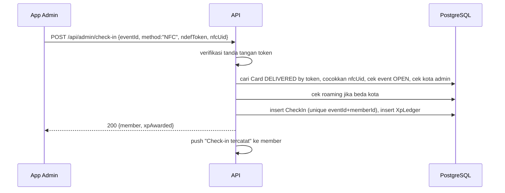
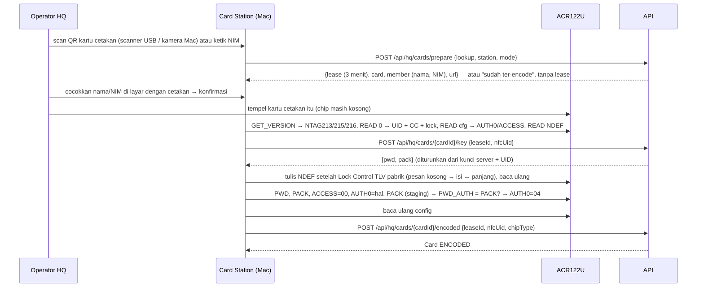

# PATS University — Build Plan (Showcase Prototype)

Versi: 1.5 — 16 Oktober 2026. Mengacu ke [PRODUCT.md](PRODUCT.md).

Tujuan plan ini: membangun prototype yang bisa didemokan end-to-end sesuai visi penuh PRD, dalam enam fase, masing-masing berakhir dengan sesuatu yang bisa diperlihatkan.

## Fokus: sistem absensi berbasis kartu lebih dulu

Keputusan owner 16 Oktober 2026: **Phase 0–2 harus menghasilkan sistem absensi kartu yang jalan end-to-end** sebelum fitur lain disentuh:

1. Registrasi web → NIM → akun.
2. Kartu NFC: HQ antrean kartu → batch → file cetak (PDF + CSV) → **vendor cetak** di NTAG213 kosong milik perusahaan → kartu kembali ke HQ → Card Station di Mac (identifikasi via QR cetakan / NIM, tulis NDEF, kunci, bind UID) → kirim ke kota → konfirmasi serah terima oleh admin lokal.
3. Kartu digital (QR berputar) sebagai fallback.
4. Scan admin (NFC / QR app / manual) + check-in + riwayat kehadiran.
5. Dasar super admin: kota, admin, member, event, halaman Kartu (antrean, batch, file cetak), settings.

XP/leaderboard/reward, laporan PR, social hub, reservasi, dan roaming **menyusul** di Phase 3–4. Tidak ada pekerjaan fase lanjut yang dimulai sebelum demo Phase 2 lolos.

---

## 1. Stack (final)

> Stack ini **final** (keputusan owner 16 Oktober 2026). Perubahan setelah ini berarti mengulang fase yang terdampak.

| Lapisan | Pilihan | Alasan |
|---|---|---|
| Mobile app (member + local admin) | **Expo (React Native)**, TypeScript, Expo Router | Satu codebase iOS + Android; EAS Build untuk TestFlight/APK; ekosistem NFC/kamera/push matang |
| NFC (app admin) | `react-native-nfc-manager` (development build, Expo Go tidak mendukung) | Core NFC (iOS, perintah MIFARE/NTAG) + NfcA transceive (Android) dalam satu API; membaca NDEF URL + UID dalam satu sesi tap, dan meng-encode kartu di HP HQ |
| Card Station (Mac HQ) | **Rust** dengan crate **`pcsc`** (PC/SC), reader **ACR122U**, kartu **NTAG213** | PC/SC bawaan macOS; `pcsc` memberi akses APDU langsung untuk tulis NDEF + proteksi password PWD/PACK (tanpa lock permanen); binary tunggal tanpa runtime, mudah dijalankan operator HQ. HTTP ke API lewat `reqwest`, CLI lewat `clap` |
| Kamera / QR | `expo-camera` (barcode scanning bawaan) | Tanpa native module tambahan |
| Push | `expo-notifications` → APNs / FCM | Satu token Expo, server kirim via Expo Push API |
| Peta / denah venue | Komponen denah sendiri (SVG/grid) + `react-native-maps` untuk lokasi venue | Denah sofa/table bukan peta geografis; grid sederhana cukup untuk demo |
| Anti-screenshot | `expo-screen-capture` | `FLAG_SECURE` Android; deteksi di iOS |
| Backend + super admin dashboard | **Next.js (App Router) + Prisma + PostgreSQL** | Pola yang sama dengan NEXUS milik owner; satu deploy untuk API + dashboard |
| Leaderboard | Query agregat `XpLedger` + snapshot per jam | Tanpa layanan tambahan |
| Auth | **Email + kode OTP 6 digit** buatan sendiri (tabel `OtpCode`), JWT access + refresh token. Pengirim OTP pluggable lewat `OTP_PROVIDER` = `email` (SMTP, dipakai sekarang) / `demo` (OTP di layar) / nanti `whatsapp-bridge` (Baileys, tidak resmi) / `cloud-api` (WhatsApp Cloud API resmi + SMS fallback) — lihat PRODUCT.md §10.6 | Tanpa vendor; pindah ke OTP HP tinggal ganti provider |
| Realtime chat | **Socket.IO** (server terpisah kecil di repo yang sama) | Lihat §1.1 |
| File / media | **Antarmuka storage**: driver **local disk** (volume Docker) sebagai default, driver **S3-compatible** di balik config (`STORAGE_DRIVER=s3`) | File disajikan route handler yang mengecek akses; MinIO dihapus 16 Okt (image tidak bisa di-pull lagi) |
| Job terjadwal | Cron di server (endpoint `/api/cron/*` dipanggil systemd timer) | Reminder H-3/H-1/H, follow-up 12.00, expiry roaming/redeem |
| Export | CSV/XLSX via `exceljs`; PDF = print view | Cukup untuk demo |
| Hosting | Infrastruktur VM owner yang sudah ada (Docker Compose, reverse proxy, TLS), domain **`patsuniv.znetworks.id`** | Tidak butuh layanan baru; DNS + tunnel dipasang sesi server utama di akhir Phase 0 |

### 1.1 Realtime: Socket.IO vs Supabase Realtime

Dipilih **Socket.IO**:

- Stack sudah Prisma + PostgreSQL biasa, bukan Supabase; menambah Supabase hanya untuk realtime berarti dua sumber kebenaran untuk auth dan row-level security.
- Chat PATS butuh logika server (mention `@ADMIN` → push ke admin, region lock, roaming expiry) yang lebih mudah ditulis di handler Socket.IO daripada di policy Postgres.
- Pola ini sudah dipakai owner di NEXUS (room per workspace), sehingga risiko dan operasionalnya dikenal.
- Supabase Realtime lebih cocok jika kelak ingin menghapus server chat sendiri; tercatat sebagai alternatif.

---

## 2. Arsitektur

```mermaid
flowchart TB
  subgraph Clients
    M[App Member/Admin\nExpo RN iOS+Android]
    W[Web Registrasi\npublic]
    H[Super Admin Dashboard\nweb]
    CS[Card Station\nMac + ACR122U]
  end

  subgraph Server["apps/web (Next.js)"]
    API[REST API /api/*]
    DASH[Dashboard pages]
    CRON[/api/cron/*]
  end

  RT[Socket.IO server\napps/realtime]
  DB[(PostgreSQL)]
  OBJ[(Object storage\nS3-compatible)]
  PUSH[Expo Push → APNs / FCM]
  TIMER[systemd timer]

  M -->|HTTPS JWT| API
  M -->|WSS JWT| RT
  W --> API
  H --> DASH
  CS -->|HTTPS token super admin| API
  DASH --> API
  API --> DB
  RT --> DB
  API -->|presigned URL| OBJ
  M -->|upload/download| OBJ
  API --> PUSH
  CRON --> PUSH
  TIMER --> CRON
  API -->|publish event| RT
```

Prinsip:

- **Server adalah sumber kebenaran** untuk check-in, XP, redeem, spin, roaming expiry. App tidak pernah menghitung sendiri.
- **Satu API** untuk app dan dashboard; dashboard memakai server component + route handler yang sama.
- **Role & kota dicek per endpoint** (middleware `requireRole`, `requireCityAccess`).
- **Realtime** hanya untuk chat, timeline, dan feed kehadiran live di layar admin; selain itu REST.

### 2.1 Alur scan (Phase 1–2)



Untuk `APP_QR`: app member minta `GET /api/me/card-token` tiap 30–60 detik (token HMAC `{memberId, nonce, exp}`); admin memindai, mengirim `{method:"APP_QR", token}`; server memverifikasi tanda tangan, exp, dan nonce sekali pakai (tabel `UsedNonce` atau cache).

### 2.2 Alur encode kartu (Card Station, Phase 2)



Catatan teknis:

- **Koreksi Phase 2**: perintah ke chip lewat ACR122U memakai `FF B0 00 <page> 10` (READ) dan `FF D6 00 <page> 04 <data>` (WRITE), terverifikasi di reader HQ 16 Okt; `GET_VERSION` dan `PWD_AUTH` lewat Direct Transmit + PN532 InCommunicateThru `FF 00 00 00 Lc D4 42 <perintah>`. (Versi awal plan menulis `FF 00 00 00 Lc <perintah>` tanpa `D4 42`; itu bukan perintah PN532 yang valid.)
- **Chip**: NTAG213, 215, dan 216 (vendor kehabisan 213). Dideteksi dengan GET_VERSION (byte ukuran 0Fh/11h/13h) dan dicocokkan dengan byte ukuran CC halaman 3 (12h/3Eh/6Dh). Halaman config (dynamic lock, CFG0, CFG1, PWD, PACK) = 28h–2Ch / 82h–86h / E2h–E6h. Jenis chip disimpan di `Card.chipType`.
- NDEF URL dengan prefix `https://` memakai URI identifier code `0x04`, dibungkus TLV `03 <len> ... FE`, ditulis **setelah TLV yang sudah ada di chip** (Lock Control TLV pabrik `01 03 A0 0C 34` di 213; nilainya beda per chip, dibaca dan dipertahankan apa adanya). Kapasitas user 144/504/888 byte, cukup untuk `https://patsuniv.znetworks.id/c/<token 32 char>` (±60 byte payload).
- **Domain final `patsuniv.znetworks.id`** dan URL `/c/<token>` **permanen dalam praktik**: tertulis di tag yang diproteksi password dan kartu di lapangan tidak bisa diperbarui dari jauh (hanya Card Station HQ yang bisa menulis ulang), jadi subdomain ini harus dipertahankan selamanya (redirect bila kelak pindah domain). Lihat PRODUCT.md §10.7.
- `AUTH0 = 0x04` (koreksi Phase 2, keputusan owner: proteksi mulai halaman NDEF pertama) berarti halaman 4 ke atas butuh autentikasi untuk **tulis** (`PROT = 0` = hanya tulis yang diproteksi; baca tetap bebas agar HP member bisa membaca NDEF). `AUTHLIM` diset 0 (tanpa batas percobaan) untuk menghindari kartu terkunci permanen akibat salah proses.
- Urutan aman: password ditulis lalu **dibuktikan** dengan PWD_AUTH selagi AUTH0 hanya melindungi halaman PACK; baru setelah PACK cocok AUTH0 turun ke 04h. Gagal → AUTH0 kembali FFh. Sesi yang terputus di langkah mana pun meninggalkan chip tanpa proteksi atau terproteksi dengan password yang bisa dihitung server (diuji dengan memutus simulasi di setiap perintah).
- **Encode paralel**: beberapa stasiun (Card Station Mac + HP Super Admin) bisa meng-encode satu batch bersamaan. `prepare` memberi **lease** 3 menit pada kartu (update bersyarat di baris kartu, jadi dua stasiun tidak bisa memegang kartu yang sama); `key` memperpanjang lease; `encoded` dengan lease yang sudah kedaluwarsa diterima selama belum diambil stasiun lain. Encode idempoten: kartu yang sudah `ENCODED` tidak ditulis ulang kecuali operator memilih re-encode.
- PWD per kartu diturunkan server dari kunci rahasia + UID (HMAC, 4 byte) sehingga HQ bisa menghitung ulang untuk re-encode; tidak disimpan di DB.
- **Cetak dulu, encode belakangan**: token kartu dibuat saat batch (isi QR cetakan) dan token yang sama ditulis ke NDEF saat encode, jadi QR cetakan adalah kunci identifikasi kartu fisik di Card Station. Server menolak encode bila status kartu bukan `RECEIVED_HQ` (atau re-encode yang disetujui) dan bila UID sudah terpakai kartu lain.
- Bit `Capability Container`, `static lock`, dan `dynamic lock` **tidak** disentuh: chip **diproteksi password, bukan dikunci permanen**. Hanya Card Station HQ (yang tahu PWD dari kunci server + UID) yang bisa menulis ulang — untuk memperbaiki kartu salah encode, memakai ulang kartu untuk member lain, atau mengganti token.

---

## 3. Struktur repo (monorepo)

```
pats-univ/
├── apps/
│   ├── mobile/            # Expo RN: member + local admin (role-based)
│   │   ├── app/           # Expo Router: (auth), (member), (admin)
│   │   ├── src/
│   │   │   ├── api/       # client API (generated types dari packages/shared)
│   │   │   ├── features/  # card, checkin, events, rewards, hub, reservation, roaming
│   │   │   ├── components/
│   │   │   └── i18n/      # en.json, id.json
│   │   └── app.config.ts
│   ├── web/               # Next.js: API + registrasi public + super admin dashboard
│   │   ├── app/
│   │   │   ├── (public)/join/      # web registrasi
│   │   │   ├── (admin)/            # dashboard HQ
│   │   │   └── api/                # route handlers
│   │   ├── prisma/schema.prisma
│   │   └── src/lib/       # auth, otp, xp, checkin, nim, push, export, card-print (template HTML/SVG → PDF)
│   └── realtime/          # Socket.IO server (chat, timeline, live attendance)
├── packages/
│   ├── shared/            # tipe, enum, validator (zod), konstanta, format angka/tanggal
│   └── ui-tokens/         # warna, spasi, tipografi dipakai mobile & web
├── tools/
│   └── card-station/      # Mac + ACR122U: encode NTAG213 (Rust, crate pcsc)
│       ├── Cargo.toml
│       ├── src/
│       │   ├── main.rs    # CLI: login, batches, encode (scan QR / NIM, re-encode, --dry-run), status, read, plan
│       │   ├── ntag.rs    # NTAG213/215/216: deteksi chip, NDEF, urutan encode + proteksi PWD/PACK (tanpa lock bit), simulator
│       │   ├── reader.rs  # ACR122U: APDU FF B0 / FF D6 / D4 42, dry run
│       │   ├── qr.rs      # identifikasi: URL cetakan atau NIM; kamera Mac lewat helper camera/qr-scan.swift
│       │   └── api.rs     # klien API (login, batches, prepare, key, encoded, release)
│       └── README.md      # setup PC/SC + ACR122U di macOS
├── docs/
│   ├── PRODUCT.md
│   ├── PLAN.md
│   ├── DESIGN.md          # token, tipografi, pola komponen (diturunkan sebelum layar pertama)
│   └── STATUS.md          # progres per fase (diisi saat build)
├── infra/
│   ├── docker-compose.yml # web (+ Chromium, volume storage), realtime, postgres
│   └── deploy.sh
├── package.json           # pnpm workspaces
└── README.md
```

Alasan monorepo: tipe dan validator dibagi (`packages/shared`) agar app, dashboard, dan server tidak saling meleset; satu PR bisa mencakup server + web + mobile untuk satu fitur (aturan paritas).

---

## 4. Fase

Setiap fase diakhiri **demo yang bisa diperlihatkan** dan `docs/STATUS.md` diperbarui. Estimasi dalam hari kerja satu engineer penuh waktu; QA interaksi masuk ke dalam estimasi.

### Phase 0 — Skeleton, auth, registrasi web

**Isi**

- Monorepo, Docker Compose (postgres, minio, web, realtime kosong), CI lint + typecheck.
- Schema Prisma lengkap untuk seluruh entitas §7 PRODUCT.md (migrasi awal), seed: 3 kota, 1 super admin, 2 local admin, 20 member, 2 venue, 3 event.
- Auth: **email + kode OTP 6 digit**, JWT access/refresh, role dari `User` (email unik = identitas login; phone wajib untuk grup WA); middleware role & kota. Modul `OtpSender` dengan provider dipilih lewat env `OTP_PROVIDER`: `email` (SMTP, env `SMTP_*`, template EN/ID) dipakai sekarang, `demo` (OTP tampil di layar / respons API) untuk showcase. Provider HP (`whatsapp-bridge`, `cloud-api`/Firebase) hanya disiapkan sebagai antarmuka, tidak dibangun di Phase 0 (PRODUCT.md §10.6).
- **Web registrasi** `/join`: form (nama, DOB, kota, song & genre, quotes, **email wajib** (login), **nomor WA wajib** (grup kota)), verifikasi email lewat OTP, cek `minAge`, generate NIM, halaman sukses dengan link grup WA + link download app, email konfirmasi (SMTP yang sama dengan OTP).
- **Akhir Phase 0**: DNS `patsuniv.znetworks.id` + tunnel ke VM dipasang oleh sesi server utama owner (di luar estimasi engineer); sejak itu `/join` dan dashboard tersaji di domain final.
- Dashboard HQ: login, layout, halaman Kota, Admin, Member (list + detail), Settings (semua key §9).
- App: shell Expo, login email + OTP, routing berdasarkan role, i18n EN/ID, tab bar member dan menu admin kosong.

**Demo**: scan QR → daftar di web dengan email + nomor WA (OTP masuk ke email; di showcase mode `demo` menampilkannya di layar) → NIM muncul → login di app dengan email itu → profil tampil; HQ melihat member baru di dashboard dan mengubah `minAge`.

**Effort**: 6–8 hari.

### Phase 1 — Kartu digital, scan admin, check-in

**Isi**

- Kartu digital di app: tampilan KTM + QR berputar (token HMAC, TTL dari setting), status kartu fisik.
- Event: list & detail di app (kota asal), CRUD di dashboard dan di menu admin app; status `OPEN`/`CLOSED` + jendela check-in.
- Mode **Scan** admin: kamera QR (`APP_QR`) dan manual (cari nama + alasan). Layar hasil: nama, foto, NIM, konfirmasi.
- `POST /api/admin/check-in` dengan validasi §6.1 PRODUCT.md, unik per event, metode tercatat. Entri `XpLedger` sudah ditulis di sini (angka dari setting) tetapi **tidak ditampilkan** sampai Phase 3.
- Riwayat kehadiran di app (member) dan daftar kehadiran per event di app admin + dashboard. Feed kehadiran live di layar admin (REST polling dulu; realtime di Phase 4).
- `AuditLog` untuk manual check-in.

**Demo**: admin membuka event, member menunjukkan QR app, admin scan → check-in tercatat, riwayat muncul di app member, daftar hadir muncul di dashboard; scan kedua ditolak; screenshot QR lama ditolak setelah TTL; manual check-in wajib alasan dan tercatat di audit.

**Effort**: 6–8 hari.

### Phase 2 — Kartu NFC, antrean & file cetak, push

**Isi**

- **Card Station** (`tools/card-station`, Rust + `pcsc`, Mac + ACR122U), dipakai saat kartu cetakan kembali dari vendor (`RECEIVED_HQ`): login super admin → pilih batch → per kartu: **identifikasi member dengan scan QR cetakan (kamera Mac) atau ketik NIM** → cocokkan nama di layar dengan cetakan → tempel kartu cetakan (chip kosong) → baca UID → tulis NDEF URL `https://patsuniv.znetworks.id/c/<token>` → set PWD/PACK + AUTH0 (proteksi tulis, bukan lock permanen) → verifikasi baca ulang → lapor `ENCODED` ke server. Mode re-encode (PWD dihitung ulang dari UID) untuk kartu salah encode, kartu dipakai ulang untuk member lain, atau token diganti. Lihat §2.2.
- Endpoint `/api/hq/cards/prepare` dan `/api/hq/cards/{id}/encoded`; `/c/<token>` di web: jika app terpasang → universal link ke profil, jika tidak → halaman profil ringkas + link download.
- NFC di app admin (`react-native-nfc-manager`): baca NDEF + UID dalam satu sesi; alur **Serah terima kartu** (tap → server cocokkan token+UID → `DELIVERED`, tanpa pilih member), **Lapor hilang** (`REVOKED`).
- `CheckIn` metode `NFC` dengan verifikasi token + UID; urutan fallback NFC → APP_QR → MANUAL tampil di UI admin.
- Deep link `/c/<token>` di app member (universal link iOS + app link Android; AASA `/.well-known/apple-app-site-association` dan `/.well-known/assetlinks.json` disajikan dari `patsuniv.znetworks.id`): tap kartu sendiri di iPhone XS+ membuka profil.
- Dashboard HQ: halaman **Kartu** — antrean member tanpa kartu (`NOT_PRINTED`) per kota → buat batch (server membuat `Card` + token → `IN_BATCH`) → **unduh file cetak**: PDF per member (CR80 85,6 × 54 mm + bleed 3 mm, 300 dpi, depan + belakang: hanya nama, NIM, QR `https://patsuniv.znetworks.id/c/<token>` + artwork; song & genre dan quotes tidak dicetak), PDF gabungan batch, CSV manifest vendor; render template HTML/SVG → PDF di server (Chromium headless), hasil disimpan ke object storage → tandai `SENT_TO_VENDOR` → `RECEIVED_HQ` → progres encode → `SHIPPED_TO_CITY`; daftar kartu belum `DELIVERED`. Artwork dari tim (T8c) masuk sebagai template; sebelum ada, placeholder desain.
- Push: registrasi device, Expo Push, pusat notifikasi, pengaturan kategori; cron reminder H-3/H-1/H dan follow-up 12.00 (terima kasih / FOMO); copy per kota dari `City.notificationCopy`; broadcast event dari dashboard (flyer + push).
- Audit metode check-in di dashboard (persentase NFC / APP_QR / MANUAL per event).

**Demo**: HQ membuat batch dari antrean dan mengunduh PDF per member + PDF batch + CSV manifest (dicek ukuran CR80 + bleed); batch ditandai `SENT_TO_VENDOR` → `RECEIVED_HQ` (untuk demo: cetak stiker/label dengan QR di NTAG213 kosong); di Mac, Card Station memindai QR cetakan → nama & NIM tampil → tap kartu → tulis + proteksi password → `ENCODED`; scan QR kartu lain lalu tap kartu yang salah → ditolak; mencoba menulis ulang kartu dengan app NFC umum → gagal, tetapi Card Station bisa re-encode kartu yang sama untuk member lain; admin menerima kartu, tap saat serah terima → `DELIVERED`; di event, tap kartu → check-in `NFC`; kartu dilaporkan hilang → revoke, token+UID lama ditolak; member tap kartunya sendiri di iPhone → profil terbuka; push reminder dan FOMO sampai ke HP demo.

**Tambahan owner 16 Okt (masuk Phase 2)**:

- **Encode di HP oleh Super Admin**: menu Admin → Encode kartu, langkah sama dengan Card Station (password per kartu dari server, hanya untuk satu penulisan; HP tidak menyimpan rahasia apa pun). Android: NfcA transceive; iOS: Core NFC MIFARE (NTAG).
- **Permintaan encode ulang** oleh admin kota (dibatasi capability `card.requestReencode`, bukan nama role, supaya peran regional manager — pertanyaan S1 — bisa menerimanya tanpa ubah alur): alasan wajib → antrean di dashboard HQ (setujui/tolak) → izin **sekali pakai 24 jam** untuk kartu itu saja di HP admin yang meminta → semua tercatat di audit. Chip mati → "Laporkan hilang atau rusak" (REVOKED + pengganti di antrean).
- **Encode paralel di HQ** dengan lease per kartu (lihat §2.2); halaman Kartu menampilkan progres per batch dan stasiun yang meng-encode tiap kartu.
- **NTAG215/216** didukung selain 213.

**Effort**: 9–11 hari (termasuk Card Station ±2–3 hari). Hardware sudah ada: NTAG213 PVC + ACR122U; perlu iPhone + Android fisik untuk uji.

**Gerbang**: demo Phase 2 harus lolos end-to-end (registrasi → encode → serah terima → check-in NFC → riwayat → dashboard) sebelum Phase 3 dimulai.

### Phase 3 (historis; aturan diganti Phase 5) — XP, leaderboard, reward, spin wheel, laporan PR, recap & export

**Isi**

- XP tampil di app: saldo, ledger, milestone; setting `xpPerCheckIn` dari dashboard (entri ledger sudah ada sejak Phase 1).
- Leaderboard kota & nasional: query agregat per periode + `LeaderboardSnapshot` per jam (cron), tie-break sesuai §6.6 PRODUCT.md, posisi sendiri selalu tampil; halaman leaderboard di dashboard.
- Katalog reward di dashboard (setting XP, stok, kota), tampilan di app.
- **Laporan PR**: flag `isPromoter` (diberi dari dashboard/app admin — mekanisme final TBD), menu PR di app: form tamu + unggah foto struk ke bucket privat (presigned URL, akses bertanda tangan berumur pendek), daftar laporan di app admin dengan validasi/tolak, bonus dikreditkan sesuai `promoterBonusKind` (XP → `XpLedger`; CASH → `PromoterPayout`), laporan + struk di recap dashboard dan export.
- Direct redeem: `Redemption` dengan kode 6 karakter + QR, TTL, refund otomatis saat kedaluwarsa.
- Validasi crew: scan/masukkan kode → `FULFILLED`; penolakan untuk kode terpakai/kedaluwarsa.
- Spin wheel: hasil server dengan bobot, batas spin per event, animasi di app, hadiah masuk sebagai `Redemption` tipe `SPIN`.
- Traffic recap: form admin per event (sofa, table, FDC, pax, revenue), total otomatis, kunci oleh HQ.
- Dashboard HQ: recap global, filter, export 1-klik (CSV/XLSX) untuk member, check-in, XP, redemption, recap. Dashboard kota untuk admin di app.

**Demo**: XP dari check-in Phase 1–2 muncul di app; leaderboard Jakarta dan nasional menampilkan peringkat, member melihat posisinya; member menukar XP → kode muncul → crew validasi → kode kedua kali ditolak; member spin 5 kali, spin keenam ditolak; PR mengirim laporan 12 tamu + foto struk → admin validasi → bonus masuk → laporan dan struk tampil di recap HQ (struk hanya bisa dibuka admin); admin mengisi recap → HQ export XLSX dengan angka format `3.800` / `Rp 6.000.000`.

**Effort**: 10–12 hari.

### Phase 4 (historis; aturan diganti Phase 5) — Social hub, reservasi, roaming

**Isi**

- Socket.IO server: auth JWT, room per channel kota, pesan teks, voice note & video pendek (presigned upload ke object storage), mention `@ADMIN` → push ke admin kota, riwayat 30 hari.
- Timeline per kota: post foto/teks, pin, hapus, mute (moderasi admin). Channel management di app admin dan di dashboard.
- Anti-screenshot: `FLAG_SECURE` di layar hub Android; deteksi di iOS → catat `ScreenshotEvent` + peringatan.
- Reservasi venue: editor denah sederhana di dashboard (grid slot sofa/table), pemilihan slot di app, `Conversation` reservasi member ↔ admin, konfirmasi/tolak, unik per slot per event.
- Roaming: request `ATTENDANCE` (approve Local Admin tujuan) dan `SOCIAL_HUB` (approve HQ), push ke approver dan pemohon, `accessExpiresAt` = endsAt + 48 jam, cron expiry, check-in roaming di scan admin.
- Feed kehadiran live di layar admin dipindah ke Socket.IO.

**Demo**: member Jakarta chat di hub Jakarta dengan voice note; mention `@ADMIN` → admin dapat push; member Bandung minta roaming ke event Jakarta → admin Jakarta approve absensi, HQ approve hub → member Bandung melihat hub Jakarta; 48 jam disimulasikan dengan mengubah setting → akses hilang; reservasi sofa dikonfirmasi admin; screenshot hub di Android gagal, di iOS tercatat.

**Effort**: 10–12 hari.

### Phase 5 — Keputusan tim 16 Oktober dan Claim XP

**Hasil**: aturan aktif mengikuti PRODUCT §12. Implementasi dan demo terperinci: [PHASE5-REPORT.md](PHASE5-REPORT.md).

- Migrasi Regional Admin satu kota, alias API lama, capability checks dan dashboard regional; batas lima admin dengan city lock.
- Welcome 100 sekali, check-in 50 + confirmed reservation 25; katalog reward per venue; expiry XP 18 bulan dan refund membawa expiry asli.
- Live draw event: hadiah/peak hour/kapasitas, lima nama, 250 XP, satu entry/member, slot dikunci DB, draw random sekali, audit dan Socket.IO. Menggantikan wheel berbobot.
- Kuartal kalender WIB: #1 setiap kota mendapat satu free slot untuk event berikutnya/pilihan HQ; expiry tiga bulan dari tutup kuartal dan konsumsi CAS.
- **Addendum menggantikan OPEN-3:** menu Claim XP untuk PR dan member setelah `endsAt`; kedua form, receipt opsional, edit pending, unik member/event/form. Regional app/web queue adjust/approve/reject; bonus otomatis sekali, audit sebelum/sesudah, notifikasi dan private wallet room. Admin tidak memasukkan recap PR atas nama member.
- HQ-only timeline + reaksi; recap menambah PIC dan accountable; PR badge/appointment tetap.
- Kartu pengganti Rp100.000 dengan pencatatan pembayaran; request pindah kota diputuskan HQ, NIM/kartu tetap; anonimkan profil saat keluar, simpan ledger/kehadiran.
- Reservasi regional dengan minimum charge venue/slot; satu unpaid lintas event sampai DP dicatat. Roaming 48 jam tanpa batas default.
- Production seed JKT/JOG, demo memisahkan data contoh. Artwork/legal tetap placeholder. `{city}` terisi pada push; copy verbatim T9 belum ada di sumber, jangan menandai fallback sebagai final.

**Verifikasi**: unit ledger/tie-break/refund/formula dan logika layar mobile, typecheck/lint, migrasi legacy account, matriks HTTP/PostgreSQL/Socket.IO dengan race nyata, satu build Next.js di akhir. Tidak menjalankan simulator, emulator, Metro atau native build. Gerbang resource: free memory ≥25%, load1 <15, tanpa xcodebuild/build/install lain.

**Changelog 16 Oktober**: tambahkan Phase 5; default dan demo historis Phase 3/4 di atas tidak lagi menjadi spesifikasi aktif. Deploy/merge dilakukan sesi utama; push, artwork, legal dan QA perangkat fisik tercatat eksplisit pada laporan.

### Ringkasan effort

| Fase | Hari kerja | Kumulatif |
|---|---|---|
| 0 | 6–8 | 6–8 |
| 1 | 6–8 | 12–16 |
| 2 | 9–11 | 21–27 |
| **Gerbang: absensi kartu end-to-end** | | **±4–5 minggu** |
| 3 | 10–12 | 31–39 |
| 4 | 10–12 | 41–51 |
| Buffer QA + polish + demo prep | 5 | 46–56 |

Perkiraan total **9–12 minggu** satu engineer; dua engineer (mobile + server) memangkas ke **6–8 minggu** karena Phase 1–4 bisa paralel setelah schema dikunci di Phase 0. Sistem absensi kartu (Phase 0–2) siap didemokan dalam **±4–5 minggu** satu engineer.

---

## 5. Risiko

| Risiko | Dampak | Mitigasi |
|---|---|---|
| Core NFC iOS hanya membaca saat sesi aktif dan butuh entitlement; perilaku beda per model iPhone | Bind/scan tidak jalan di demo | Uji di device fisik sejak awal Phase 2; fallback APP_QR selalu tersedia |
| Vendor salah memasangkan file cetak dengan kartu, atau kartu tertukar saat kembali ke HQ | Nama tercetak tidak cocok dengan chip | Cetak dulu, encode belakangan: Card Station mengidentifikasi kartu dari QR cetakan dan operator mencocokkan nama sebelum tulis; token di QR = token di NDEF |
| File cetak tidak sesuai spek vendor (ukuran, bleed, resolusi, warna) | Batch ditolak / dicetak ulang | Template CR80 + bleed 3 mm, 300 dpi, uji 1 proof dari vendor sebelum batch pertama; artwork final dari tim (T8c) |
| ACR122U di macOS: driver PC/SC bawaan kadang bentrok dengan `ifdhandler` ACS; reader mode "escape" perlu plist | Card Station tidak melihat reader | Dokumentasi setup di `tools/card-station/README.md`; uji di Mac HQ sejak awal Phase 2 |
| Salah urutan proteksi NTAG213 (AUTH0/PWD) atau tersentuhnya lock bit bisa mengunci kartu permanen | Kartu terbuang | Verifikasi tulis sebelum set AUTH0; AUTHLIM = 0; jangan pernah set static/dynamic lock bit; uji di 5 kartu pertama |
| Token + UID masih bisa diemulasi dengan magic card | Check-in palsu | Diterima (admin melihat orangnya); jalur upgrade ke NTAG 424 DNA (SUN) |
| QR app discreenshot | Check-in palsu | TTL 30–60 detik + nonce sekali pakai |
| Push tidak sampai (APNs key, FCM config, token kadaluarsa) | Reminder & FOMO gagal | Checklist konfigurasi EAS; log pengiriman per `Notification`; retry |
| OTP email masuk spam / terlambat (SMTP) | Login member tertunda | Domain pengirim dengan SPF/DKIM, kirim ulang dengan jeda, `demo` untuk showcase |
| Bila kelak pindah ke OTP HP: `whatsapp-bridge` tidak resmi (Baileys), nomor bisa diblokir Meta, sesi bisa putus (terjadi di setup Hermes owner, Jul 2026) | OTP tidak sampai, login macet | Nomor WA khusus; rate limit; fallback OTP di layar selalu aktif; hanya untuk uji internal; produksi pakai Cloud API resmi + SMS, verifikasi Meta Business dimulai jauh sebelumnya (T17) |
| Chat realtime pada demo depth | Lag/putus saat demo | Satu channel per kota, batas media, reconnect otomatis di client |
| Anti-screenshot iOS tidak bisa dipaksa | Ekspektasi tim berbeda | Ditulis eksplisit di PRODUCT.md §10.4; tampilkan deteksi di demo |
| XP/reward/bonus PR/periode leaderboard berubah setelah coding | Rework | Semua angka sebagai setting; UI membaca setting, tidak hardcode; bonus PR disiapkan dua jalur (XP dan CASH) |
| Foto struk bocor | Data finansial terbuka | Bucket privat, URL bertanda tangan berumur pendek, cek role di server, tidak pernah masuk CDN publik |
| Zona waktu | Reminder salah jam | Simpan UTC, hitung jadwal per `City.timezone`, tes dengan kota di luar WIB |
| Review App Store untuk NFC & konten komunitas | Rilis TestFlight tertahan | Demo lewat TestFlight internal + APK; siapkan deskripsi penggunaan NFC/kamera |
| Data pribadi member | Kebocoran | Export hanya HQ + audit; URL media privat; DOB tidak pernah dikirim ke app lain selain pemilik |

---

## 6. Aturan repo (berlaku di semua repo owner)

1. **Commit atas nama Berlin** (`user.name=Berlin`, `user.email=bagasputro.bp@gmail.com`). Tidak ada `Co-Authored-By`, tidak ada penyebutan alat bantu apa pun di commit, kode, komentar, maupun dokumen.
2. **Branch**: `master` = rilis, `dev` = integrasi, branch fitur pendek (`feat/<nama>`) dihapus setelah merge. PR `dev → master` + tag saat rilis.
3. **String UI dua bahasa** (EN/ID) sejak awal; tidak ada teks hardcode di komponen. Komentar kode dalam bahasa Inggris.
4. **Paritas platform**: fitur member/admin harus ada di iOS dan Android di PR yang sama; fitur yang menyentuh HQ harus punya padanan di dashboard.
5. **Polish setara Notion/Linear, bahasa visual sama dengan NEXUS** (PRODUCT.md §5.4): netral tenang, satu warna aksen, hierarki jelas, spasi lega, tidak ada teks terpotong, ikon dari satu set; empty state (kenapa kosong + langkah berikutnya + tombol), loading state, error state dengan aksi, konfirmasi memakai dialog standar platform, tidak ada layar setengah jadi di `dev`.
6. **Format angka**: ribuan dengan titik (`3.800`), mata uang `Rp 6.000.000` (spasi setelah Rp, tanpa desimal); tanggal `16 Okt 2026`, jam `19.30 WIB`. Helper tunggal di `packages/shared`.
7. **Server sebagai sumber kebenaran**; klien tidak menghitung XP, hasil spin, atau expiry.
8. **Setiap perubahan harus benar-benar jalan**: dicoba pada jalur yang dipakai pengguna (device fisik untuk NFC/push), bukan hanya lolos typecheck. QA per fase menjalankan skenario power-user, bukan hanya happy path.
9. **Remote config**: aturan angka/teks baru masuk `Setting`, bukan konstanta.
10. **Status**: `docs/STATUS.md` diperbarui tiap fase selesai; keputusan baru masuk changelog PRODUCT.md.
11. **Design token & DESIGN.md**: warna, skala tipografi, radius, spasi didefinisikan sekali di `packages/shared` (`ui-tokens`) dan dipakai app Expo + dashboard web; tidak ada nilai hardcode di komponen. Sebelum layar pertama Phase 0 dibangun, tim menurunkan `docs/DESIGN.md` untuk pats-univ (pakai ulang konvensi token NEXUS bila masuk akal); setiap layar diperiksa terhadap checklist craft Impeccable sebelum merge ke `dev`.

---

## 7. Keputusan yang dibutuhkan sebelum Phase 0

| # | Keputusan | Dari |
|---|---|---|
| D1 | ~~Konfirmasi stack~~ — sudah final (§1) | — |
| D2 | Daftar kota awal + kode 3 huruf (untuk NIM dan seed) | Tim |
| D3 | Akun Apple Developer & Google Play untuk EAS Build (TestFlight + APK) | Owner |
| D4 | ~~Cara cetak per orang di kartu PVC~~ — sudah final: vendor cetak eksternal, NTAG213 kosong disuplai perusahaan, cetak dulu lalu encode di HQ (PRODUCT.md §4.1). Masih dari tim: file artwork kartu (T8c) dan satu desain vs per kota (T8b) — tidak memblokir Phase 0 | Tim |
| D5 | ~~Domain untuk web registrasi, dashboard, dan URL kartu~~ — sudah final: **`patsuniv.znetworks.id`** (PRODUCT.md §10.7); DNS + tunnel dipasang sesi server utama di akhir Phase 0 | — |
