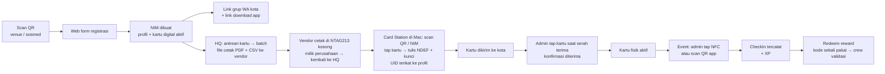

# PATS University — Product Requirements

Status: **showcase prototype**, cakupan penuh visi PRD tim.
Versi dokumen: 1.0 — 16 Oktober 2026.
Sumber: PRD + Visual Flowchart tim (4 bagian) dan keputusan owner 16 Oktober 2026. Jika keduanya berbeda, keputusan owner yang berlaku (lihat [Changelog keputusan](#changelog-keputusan)).

---

## 1. Ringkasan

PATS University adalah program keanggotaan untuk komunitas PATS di banyak kota. Setiap member punya **KTM (Kartu Tanda Mahasiswa)** fisik ber-NFC dengan NIM unik, dipakai untuk absen di event, mengumpulkan XP, menukar reward, dan masuk ke social hub kota asalnya. Admin lokal tiap kota mengelola event dan absensi lewat aplikasi yang sama; HQ mengelola seluruh kota lewat dashboard web.

Produk terdiri dari tiga permukaan:

| Permukaan | Platform | Pengguna |
|---|---|---|
| Web registrasi (public) | Web (mobile-first) | Calon member |
| Aplikasi PATS University | Android + iOS, satu app | Member, Local Admin (role dari akun) |
| Super Admin Dashboard | Web | HQ / Super Admin |
| Card Station | Tool Mac + reader ACR122U | Operator HQ (encode kartu NTAG213) |

Prototype ini dibangun untuk didemokan secara end-to-end: registrasi → kartu → check-in → XP & leaderboard → reward → laporan PR → social hub → roaming → recap. **Prioritas pertama adalah sistem absensi berbasis kartu** (registrasi, kartu NFC, kartu digital fallback, scan admin, riwayat, dasar super admin); fitur lain menyusul (urutan di PLAN.md). Bagian yang berat di back-end dikerjakan pada **demo depth** (lihat [§11](#11-di-luar-cakupan--demo-depth)).

---

## 2. Tujuan & siapa penggunanya

**Tujuan produk**

1. Identitas member yang konsisten lintas kota (KTM + NIM).
2. Absensi event yang terpercaya (admin memverifikasi orangnya, bukan hanya kode).
3. Loyalitas lewat XP dan reward yang tidak bisa diklaim ganda.
4. Komunitas tertutup per kota (social hub) dengan jalur roaming antar kota yang terkontrol.
5. Data operasional venue (traffic recap) terkumpul di satu tempat dan bisa diekspor HQ.

**Pengguna**

| Pengguna | Kebutuhan utama |
|---|---|
| Member | Daftar cepat, punya kartu, absen tanpa ribet, lihat XP & reward, ngobrol di hub kotanya, reservasi tempat |
| Local Admin (crew kota) | Scan member di pintu, serahkan kartu, validasi reward, isi recap malam itu, kelola channel hub |
| Super Admin / HQ | Lihat semua kota, siapkan batch kartu + file cetak untuk vendor, encode kartu, broadcast event, approve roaming, export data |

---

## 3. Peran

Satu akun = satu role. Role ditentukan server, bukan dipilih di app.

| Role | Permukaan | Ringkasan hak |
|---|---|---|
| `MEMBER` | App | Profil & kartu digital, check-in (discan admin), XP & leaderboard, reward, social hub kota asal, reservasi, request roaming |
| `MEMBER` + flag **PR (promoter)** | App (menu PR) | Semua hak member + kirim laporan tamu per event dengan foto struk, lihat status validasi dan bonus |
| `LOCAL_ADMIN` | App (menu Admin) | Semua hak member di kotanya + scan check-in, serah terima/revoke kartu, validasi redeem, validasi laporan PR, traffic recap, channel hub, approve roaming absensi ke kotanya |
| `SUPER_ADMIN` | Web dashboard | Kota, admin, event, member, kartu (antrean, batch, file cetak), broadcast, roaming approval (social hub), recap global (termasuk laporan PR), export, settings |

Local Admin terikat ke **satu kota**. Super Admin tidak terikat kota. PR bukan role akun terpisah, melainkan flag `isPromoter` pada `Member` (siapa yang memberi flag masih TBD, lihat §12).

---

## 4. Perjalanan utama

### 4.1 Registrasi → kartu → check-in → reward

Langkah per langkah:

1. **Scan QR** di venue atau media sosial → membuka web registrasi (`/join?src=<kode kota/sumber>`).
2. **Form registrasi**: nama, tanggal lahir, kota, favorite song & genre, quotes, **email (wajib, identitas login; OTP dikirim ke sini)**, **nomor WhatsApp (wajib, untuk grup WA kota)**. Umur minimum dicek di sini (default 18, setting).
3. **NIM dibuat** otomatis. Profil berstatus `ACTIVE`, kartu fisik berstatus `NOT_PRINTED`. Member langsung bisa login ke app dan memakai **kartu digital** (QR berputar) untuk check-in sampai kartu fisik diterima.
4. **Routing ke grup WA kota**: halaman sukses menampilkan link grup WA kota + link download app. Pesan yang sama dikirim ke email member (SMTP, pengirim yang sama dengan OTP — lihat [§10.6](#106-otp-provider)).
5. **HQ membuat batch** dari halaman **Kartu** di dashboard: antrean member tanpa kartu (`NOT_PRINTED`) per kota → pilih → `CardBatch`. Saat batch dibuat, server membuat `Card` + **token kartu** (ditandatangani, unik) untuk tiap member → status `IN_BATCH`. HQ **mengunduh file cetak**: satu PDF per member (CR80 85,6 × 54 mm + bleed 3 mm, 300 dpi, depan + belakang: **hanya nama, NIM, dan QR berisi token kartu** di atas artwork kartu — song & genre dan quotes tidak dicetak, hanya ada di profil digital `https://patsuniv.znetworks.id/c/<token>`), PDF gabungan satu batch, dan CSV manifest untuk vendor. Render dari template HTML/SVG → PDF.
6. **Cetak di vendor eksternal** — perusahaan menyuplai kartu NTAG213 kosong, vendor mencetak personalisasi di atasnya (**cetak dulu, encode belakangan**). Batch → `SENT_TO_VENDOR`; saat kartu cetakan kembali ke HQ → `RECEIVED_HQ`. Chip masih kosong di tahap ini.
7. **Card Station (HQ, Mac + ACR122U)**: untuk tiap kartu cetakan, operator **mengidentifikasi member dengan memindai QR di kartu lewat kamera Mac atau mengetik NIM**, lalu menempelkan kartu itu ke reader. Tool menulis **NDEF URL** dengan token yang sama dengan QR cetakan (domain final, lihat [§10.7](#107-domain)), mencatat UID, lalu **memproteksi tag dengan password** (NTAG213 PWD/PACK; tulis diproteksi mulai halaman AUTH0, baca tetap terbuka, PROT=0) sehingga payload **hanya bisa ditulis ulang oleh Card Station HQ** — bukan dikunci permanen, bit lock statis/dinamis tidak disentuh. Status kartu menjadi `ENCODED`; binding UID ke profil terjadi di sini. Alasan cetak dulu: nama yang tercetak harus sama dengan isi chip; meng-encode sebelum cetak berisiko tertukar di vendor. Kartu ter-encode dikirim ke kota.
8. **Serah terima**: admin lokal membuka menu *Serahkan kartu* dan **tap kartu** ke HP. App membaca NDEF, server mencocokkan token + UID dengan member → status `DELIVERED`, pengiriman terkonfirmasi. Tap ini hanya **konfirmasi penerimaan**; tidak ada binding baru.
9. **Check-in di event**: admin memilih event aktif, member menempelkan kartu ke HP admin (NFC) atau menunjukkan QR app (fallback). Server memvalidasi token NDEF + UID dan mencatat `CheckIn` + XP.
10. **Reward**: member menukar XP di app → `Redemption` dengan kode sekali pakai → crew memasukkan/scan kode → reward diserahkan.

> Menggantikan langkah PDF "Admin tap NFC kosong di venue": kartu dicetak per orang oleh vendor di NTAG213 kosong milik perusahaan, lalu di-encode dan diikat ke member di HQ (Card Station) dengan identifikasi lewat QR cetakan / NIM. Tap pertama oleh admin lokal = konfirmasi serah terima.
>
> Bonus showcase: karena isi kartu adalah NDEF URL, member yang menempelkan kartunya sendiri ke iPhone (XS ke atas, background tag reading) mendapat prompt yang membuka profilnya di app (universal link) atau di web jika app belum terpasang.

### 4.2 Event

1. Super Admin atau Local Admin membuat `Event` (kota, venue, tanggal/jam WIB, flyer, deskripsi, kuota opsional).
2. Push reminder otomatis: H-3, H-1, hari H (jam konfigurasi per kota).
3. Saat event, admin membuka mode **Scan** dan mencatat kehadiran.
4. Jam 12.00 WIB hari berikutnya: push "terima kasih" ke yang hadir, push FOMO ke member kota itu yang tidak hadir.
5. Setelah event, admin mengisi **Traffic Recap** (sofa, table, FDC, pax); sistem menghitung total; HQ bisa export.

### 4.3 Social hub

- Member hanya melihat hub **kota asal** (region-locked).
- Isi hub: **Timeline** (post foto/teks oleh admin & member sesuai setting channel), **Live Chat** per channel (teks, voice note, video pendek; mention `@ADMIN` untuk memanggil crew), dan **Reservasi venue**.
- Anti-screenshot: aktif di Android (`FLAG_SECURE`); di iOS hanya terdeteksi dan dicatat (lihat [§10](#10-keamanan--privasi)).

### 4.4 Reservasi venue

- Admin mengatur layout venue (denah sofa/table sebagai grid/koordinat sederhana) per venue.
- Member memilih event + slot (sofa/table) → `Reservation` status `PENDING` → percakapan otomatis terbuka dengan marketing/admin kota → admin `CONFIRMED` / `REJECTED`.
- Satu slot hanya bisa `CONFIRMED` untuk satu reservasi per event.

### 4.5 Roaming antar kota

Dua jenis roaming, masing-masing dengan approver berbeda:

| Jenis | Yang diminta | Approver | Berlaku sampai |
|---|---|---|---|
| `ATTENDANCE` | Absen di event kota lain | Local Admin kota tujuan | Selesai event (check-in tetap tercatat di kota asal member + kota event) |
| `SOCIAL_HUB` | Akses social hub kota lain | Super Admin (HQ) | 48 jam setelah event tujuan berakhir, lalu otomatis kembali ke hub asal |

Alur: member membuka event kota lain → *Request roaming* → notifikasi ke approver → approve/reject → member dapat push hasilnya. Setelah kedaluwarsa, akses hub lain hilang tanpa aksi manual.

### 4.6 Laporan PR (promoter)

1. Member ber-flag PR membuka event yang sudah berlangsung → *Laporan tamu* → isi jumlah tamu, opsional nama/nomor tamu, **unggah foto struk** penjualan → `PromoterReport` status `SUBMITTED`.
2. Local Admin kota event meninjau: melihat foto struk, jumlah tamu, mencocokkan dengan kehadiran → `VALIDATED` (dengan nilai bonus) atau `REJECTED` (dengan alasan).
3. Saat `VALIDATED`, bonus dikreditkan: entri `XpLedger` (jika bonus berupa XP) atau entri `PromoterPayout` (jika berupa uang) — bentuk bonus masih TBD, keduanya disiapkan.
4. Laporan + struk tampil di recap event di dashboard HQ dan ikut export.

### 4.7 XP & leaderboard

- Setiap check-in (dan bonus lain) menambah `XpLedger`. Saldo member = jumlah ledger.
- Leaderboard **per kota** dan **nasional**, periode **bulanan** (usulan, TBD): peringkat berdasarkan XP yang didapat dalam periode; seri diurutkan konsisten (XP sama → yang lebih dulu mencapai angka itu di atas → lalu NIM).
- Member melihat posisi dirinya sendiri (ditandai) walau di luar daftar teratas.

### 4.8 Recap & kontrol HQ

- Local Admin: dashboard kota (member aktif, kehadiran per event, reward tertukar, recap).
- HQ: semua kota dalam satu tabel, filter periode/kota, **export 1-klik** (CSV/XLSX; PDF di demo depth), broadcast event (flyer + push ke kota terpilih), approval roaming hub, manajemen channel global.

---

## 5. Fitur per peran

### 5.1 Member (app)

| Fitur | Keterangan |
|---|---|
| Login | **Email + kode OTP 6 digit** dikirim ke email (SMTP; provider lihat §10.6), sesi di device; satu akun bisa beberapa device. Nomor WA tidak dipakai untuk login (hanya grup WA kota) |
| Kartu digital | Tampilan KTM digital (nama, NIM, song & genre, quotes — lebih lengkap dari kartu fisik yang hanya nama, NIM, QR) + **QR berputar** (refresh 30–60 detik, ditandatangani server). Dipakai sampai kartu fisik diterima dan sebagai fallback |
| Status kartu fisik | `NOT_PRINTED` → `IN_BATCH` → `SENT_TO_VENDOR` → `RECEIVED_HQ` → `ENCODED` → `DELIVERED` (+ `REVOKED`) ditampilkan di app dengan bahasa manusia ("sedang dicetak", "dalam perjalanan ke kotamu", dst.) |
| Tap kartu sendiri | Tap KTM ke iPhone/Android sendiri → deep link ke profil di app (lewat NDEF URL) |
| Event | Daftar event kota asal + event kota lain (untuk roaming), detail, flyer, reminder |
| Riwayat kehadiran | Daftar `CheckIn` dengan event, waktu, metode |
| XP & milestone | Saldo XP, ledger, progress menuju reward berikutnya |
| Leaderboard | Peringkat kota & nasional per periode, posisi sendiri selalu terlihat |
| Menu PR (hanya flag PR) | Laporan tamu per event + foto struk, status validasi, riwayat bonus |
| Reward | Katalog, direct redeem, spin wheel (jumlah spin per event dibatasi), kode redeem sekali pakai + countdown |
| Social hub | Timeline, live chat per channel, voice note, video pendek, mention `@ADMIN` |
| Reservasi | Pilih slot dari denah, chat ke marketing, status reservasi |
| Roaming | Request absen kota lain / akses hub kota lain, status request |
| Notifikasi | Pusat notifikasi + pengaturan (reminder, hub, reward) |
| Profil | Edit song/genre/quotes/foto; nama, DOB, kota hanya lewat admin |
| Bahasa | Indonesia / English |

### 5.2 Local Admin (app, menu Admin)

| Fitur | Keterangan |
|---|---|
| Scan check-in | Pilih event aktif → mode scan: NFC (tap kartu) dan kamera (QR app). Hasil: nama, foto, NIM, status roaming, lalu konfirmasi 1 tap. Manual check-in (cari nama) tersedia dengan alasan wajib |
| Serah terima kartu | Tap kartu → app membaca NDEF → server mencocokkan token + UID → kartu `DELIVERED`; tanpa memilih member manual karena binding sudah dilakukan HQ |
| Lapor kartu hilang | Tandai `REVOKED` (token lama ditolak permanen); kartu pengganti di-encode HQ lewat Card Station dan dikirim lagi |
| Validasi reward | Masukkan/scan kode redeem → lihat reward → tandai diserahkan |
| Validasi laporan PR | Daftar laporan `SUBMITTED` di kotanya, lihat foto struk, validasi/tolak, nilai bonus dihitung dari setting |
| Event kota | Buat/edit event kotanya, lihat kehadiran live saat event |
| Traffic recap | Form per event: sofa, table, FDC, pax (+ catatan); total dihitung sistem; bisa diedit sampai dikunci HQ |
| Channel hub | Buat/arsip channel, pin post, hapus konten, mute member |
| Reservasi | Daftar reservasi masuk, konfirmasi/tolak, chat dengan member |
| Roaming absensi | Approve/reject request `ATTENDANCE` ke kotanya |
| Dashboard kota | Ringkasan member, kehadiran, reward, recap |

### 5.3 Super Admin / HQ (web)

| Fitur | Keterangan |
|---|---|
| Kota & venue | CRUD kota (kode, zona waktu, link grup WA, copy notifikasi), venue + denah |
| Admin | Undang/nonaktifkan Local Admin per kota |
| Member | Cari, lihat detail, edit data inti, nonaktifkan |
| Kartu | Halaman **Kartu**: antrean member tanpa kartu (`NOT_PRINTED`) per kota → buat batch (`IN_BATCH`, token kartu dibuat) → **unduh file cetak**: PDF per member (CR80 85,6 × 54 mm + bleed 3 mm, 300 dpi, depan + belakang; hanya nama, NIM, QR token kartu + artwork), PDF gabungan batch, CSV manifest vendor → tandai `SENT_TO_VENDOR` → `RECEIVED_HQ`; progres encode per batch; daftar kartu belum `DELIVERED`. Render HTML/SVG template → PDF |
| Card Station (tool Mac) | Tool kecil di Mac HQ dengan reader **ACR122U**, dipakai setelah kartu cetakan kembali dari vendor: identifikasi member dengan **scan QR cetakan (kamera Mac) atau ketik NIM** → tempel kartu → tulis NDEF URL bertoken (token sama dengan QR) ke **NTAG213** → catat UID → proteksi tulis dengan password (PWD/PACK, tanpa lock permanen) → status `ENCODED`. Bisa **re-encode** kartu (password diturunkan dari kunci server + UID), misalnya memakai ulang kartu untuk member lain atau mengganti token. Menyimpan hasil ke server lewat API dengan kredensial super admin |
| Revoke & rebind | Revoke token kartu hilang, encode kartu pengganti |
| Event | Semua kota; buat event lintas kota; broadcast flyer + push ke kota terpilih |
| Roaming | Approve/reject request `SOCIAL_HUB`; lihat semua request |
| Reward & XP | Katalog reward, nilai XP, aturan spin, kuota — semua sebagai setting |
| Recap global | Tabel recap per event/kota (termasuk laporan PR + struk), kunci recap, export 1-klik |
| Leaderboard | Lihat leaderboard kota/nasional per periode, atur periode & jumlah teratas |
| PR | Daftar member ber-flag PR, laporan & payout per periode (bila bonus uang) |
| Export | Member, check-in, XP ledger, leaderboard, redemption, laporan PR, recap → CSV/XLSX |
| Audit | Log aksi admin (bind/revoke kartu, manual check-in, approval) |
| Settings | Umur minimum, XP per check-in, rotasi QR, jendela roaming, waktu push per kota |

#### Dashboard super admin — daftar halaman

Urutan menu di dashboard. Halaman 1–6 adalah bagian dari **fokus sistem absensi kartu (Phase 0–2)**; sisanya menyusul di fase berikutnya.

| # | Halaman | Isi | Fase |
|---|---|---|---|
| 1 | Ringkasan | Angka per kota: member aktif, kartu per status, event terdekat, check-in hari ini | 0–2 |
| 2 | Member | Cari, detail, edit data inti, nonaktifkan, status kartu | 0–2 |
| 3 | Kartu | Antrean `NOT_PRINTED`, batch, unduh file cetak (PDF per member, PDF batch, CSV manifest), status vendor → encode → kirim, kartu belum `DELIVERED`, revoke | 0–2 |
| 4 | Kota & venue | CRUD kota (kode, zona waktu, link grup WA, copy notifikasi), venue + denah | 0–2 |
| 5 | Admin lokal | Undang/nonaktifkan Local Admin per kota | 0–2 |
| 6 | Event | Semua kota; buat/edit event, jendela check-in, daftar hadir + metode check-in | 0–2 |
| 7 | Broadcast | Flyer + push ke kota terpilih | Lanjut |
| 8 | Reward & XP | Katalog reward, nilai XP, aturan spin, leaderboard | Lanjut |
| 9 | Roaming | Approve/reject `SOCIAL_HUB`, lihat semua request | Lanjut |
| 10 | Rekap traffic | Recap per event/kota, laporan PR + struk, kunci, export | Lanjut |
| 11 | Pengaturan | Semua key §9 | 0–2 (key absensi) / Lanjut (key XP, roaming) |
| 12 | Audit log | Aksi admin: bind/revoke kartu, manual check-in, approval, export | 0–2 (dasar) / Lanjut (lengkap) |

### 5.4 Standar desain

App dan dashboard harus **bersih, setara Notion/Linear, dan memakai bahasa visual yang sama dengan NEXUS** (produk owner yang sudah jalan):

- Warna netral yang tenang, **satu warna aksen**, hierarki jelas (judul → isi → meta), jarak lega; tidak ada teks terpotong; ikon dari satu set yang konsisten.
- Setiap layar punya **empty state** (kenapa kosong + langkah berikutnya + tombol), loading state, dan error state dengan aksi.
- Format angka `3.800`, mata uang `Rp 6.000.000`, tanggal `14 Oct` (helper tunggal di `packages/shared`, lihat PLAN.md §6).
- **Design token** (warna, skala tipografi, radius, spasi) didefinisikan **sekali** di `packages/shared` dan dipakai oleh app Expo maupun dashboard web; tidak ada nilai warna/spasi hardcode di komponen.
- Sebelum layar pertama dibangun, tim menurunkan **`DESIGN.md`** untuk pats-univ (memakai ulang konvensi token NEXUS bila masuk akal), dan setiap layar diperiksa terhadap **checklist craft Impeccable** sebelum masuk `dev`.

---

## 6. Aturan

### 6.1 Check-in

1. Check-in hanya dilakukan **oleh admin** (crew yang melihat orangnya). Self check-in + GPS tidak ada di prototype ini; disiapkan sebagai opsi lanjutan untuk event tanpa crew.
2. Urutan metode: **`NFC`** (kartu fisik) → **`APP_QR`** (QR berputar di app, fallback) → **`MANUAL`** (cari nama, alasan wajib). Metode dicatat di tiap `CheckIn` agar HQ bisa mengaudit pemakaian fallback.
3. Validasi server untuk `NFC`: app admin membaca **NDEF URL** dan UID; server memverifikasi tanda tangan token, token milik kartu `DELIVERED`, **UID cocok dengan UID yang dicatat saat encode**, member aktif. UID saja (tanpa token sah) ditolak. Untuk `APP_QR`: token ditandatangani server, belum kedaluwarsa (TTL 30–60 detik), belum pernah dipakai (nonce). Untuk keduanya: event sedang `OPEN` dan admin adalah admin kota event tersebut.
4. **Satu member satu check-in per event.** Tap kedua ditolak dengan pesan "sudah check-in".
5. Member dari kota lain hanya bisa check-in jika ada `RoamingRequest` tipe `ATTENDANCE` berstatus `APPROVED` untuk event itu.
6. Jendela check-in: dari `checkInOpensAt` sampai `checkInClosesAt` event (default: 1 jam sebelum mulai sampai event berakhir; setting).

### 6.2 XP & reward — placeholder (TBD)

Nilai di bawah **belum diputuskan** tim dan hanya placeholder untuk demo. Semua adalah **setting di dashboard**, bukan hardcode.

| Setting | Placeholder | Status |
|---|---|---|
| XP per check-in | 50 XP | TBD |
| Direct redeem contoh | 100 XP = 1 cocktail | TBD |
| Spin wheel | 250 XP = 1 spin | TBD |
| Maksimum spin | 5 spin per member per event | TBD |
| Isi roda & probabilitas | 6 slot contoh, bobot sama | TBD |
| XP kedaluwarsa | Tidak ada | TBD |

Aturan yang sudah tetap:

- XP dicatat sebagai **ledger** (`XpLedger`), bukan saldo yang ditimpa. Saldo = jumlah ledger.
- Pengurangan XP hanya lewat redeem/spin; pembatalan redeem mengembalikan XP lewat entri ledger baru.
- Spin wheel: satu spin = satu entri `Redemption` tipe `SPIN` dengan hasil tersimpan di server (bukan dihitung di app).

### 6.3 Redeem — kode sekali pakai

1. Member menekan *Redeem* → server mengurangi XP dan membuat `Redemption` berstatus `ISSUED` dengan **kode 6 karakter** + QR, berlaku 15 menit (setting).
2. Crew memasukkan/scan kode → server mengecek: kode ada, `ISSUED`, belum kedaluwarsa, event/kota cocok → status `FULFILLED` + admin yang memvalidasi.
3. Kode yang sudah `FULFILLED` atau `EXPIRED` ditolak. Kode kedaluwarsa mengembalikan XP otomatis.
4. Satu reward tidak bisa diklaim dua kali karena transisi status dilakukan atomik di server.

### 6.4 Umur

- Tanggal lahir **wajib** saat registrasi.
- Umur minimum = setting `minAge` (default **18**, belum final). Dicek saat registrasi; yang tidak memenuhi ditolak dengan pesan jelas dan data tidak disimpan.

### 6.5 Roaming

- `ATTENDANCE`: disetujui Local Admin kota tujuan; berlaku untuk satu event.
- `SOCIAL_HUB`: disetujui HQ; akses hub tujuan **kedaluwarsa 48 jam** (setting) setelah event tujuan berakhir. Setelah itu akses kembali ke hub asal otomatis.
- Request tanpa keputusan sampai event dimulai menjadi `EXPIRED`.
- Satu member maksimum satu request aktif per event per jenis.

### 6.6 Leaderboard — placeholder (TBD)

| Setting | Placeholder | Status |
|---|---|---|
| Periode | Bulanan (1 s.d. akhir bulan, WIB) | TBD |
| Cakupan | Kota + nasional | Tetap |
| Jumlah teratas ditampilkan | 50 | TBD |
| Tie-break | XP periode sama → waktu mencapai angka itu lebih dulu → NIM lebih kecil | Tetap |
| Hadiah peringkat | Tidak ada (hanya tampilan) | TBD |

### 6.7 Laporan PR — placeholder (TBD)

- Hanya member ber-flag PR yang bisa mengirim; satu laporan per PR per event (bisa diedit selama masih `SUBMITTED`).
- Foto struk wajib; jumlah tamu wajib; nama/nomor tamu opsional.
- Validasi hanya oleh Local Admin kota event (atau HQ). Bonus dikreditkan sekali saat `VALIDATED`; pembatalan membuat entri pembalik.
- **TBD**: bentuk bonus (XP tetap per tamu, XP per nominal struk, komisi % dari struk, atau nominal per tamu) dan siapa yang memberi flag PR (Local Admin menunjuk vs member mengajukan lalu disetujui). Placeholder demo: 20 XP per tamu tervalidasi.

### 6.8 NIM — usulan format

Format diusulkan (belum final): **`<kode kota 3 huruf><yy><5 digit urut>`**, contoh `JKT2600042` = Jakarta, registrasi 2026, urutan ke-42 di kota itu tahun itu. Urutan di-reset per kota per tahun. NIM tidak berubah walau member pindah kota.

---

## 7. Data utama

Nama entitas dan field inti (teknis detail ada di PLAN.md / schema).

| Entitas | Field inti | Catatan |
|---|---|---|
| `User` | id, email (unik, identitas login), phone (wajib, E.164, untuk grup WA kota), role, cityId (admin), status | Akun login lewat email + OTP; member & admin sama-sama `User` |
| `Member` | id, userId, nim, fullName, dateOfBirth, cityId (asal), favoriteSong, favoriteGenre, quotes, photoUrl, isPromoter, promoterSince, joinedAt, status | Satu `User` role `MEMBER` = satu `Member` |
| `Card` | id, memberId, nfcUid (unik, nullable, diisi saat encode), ndefToken (unik, ditandatangani, dibuat saat masuk batch = isi QR cetakan), status (`NOT_PRINTED`/`IN_BATCH`/`SENT_TO_VENDOR`/`RECEIVED_HQ`/`ENCODED`/`DELIVERED`/`REVOKED`), batchId, printFileUrl, encodedAt, encodedByUserId, lockedAt, deliveredAt, deliveredByAdminId, revokedAt, revokeReason | Member bisa punya banyak `Card` (riwayat), hanya satu `DELIVERED`. Password tag tidak disimpan per kartu; diturunkan dari kunci server + UID |
| `CardBatch` | id, cityId, status (`EXPORTED`/`SENT_TO_VENDOR`/`RECEIVED_HQ`/`ENCODING`/`SHIPPED_TO_CITY`/`DONE`), cardCount, encodedCount, exportedAt, sentToVendorAt, receivedHqAt, shippedToCityAt, batchPdfUrl, manifestCsvUrl, vendorNote | Satu batch = satu kali cetak vendor + encode per kota; file per member ada di `Card.printFileUrl` |
| `City` | id, code (3 huruf), name, timezone (default `Asia/Jakarta`), waGroupUrl, notificationCopy (JSON), settings (JSON) | Copy push per kota ada di sini |
| `Venue` | id, cityId, name, address, lat, lng, layout (JSON: slot sofa/table + koordinat) | Denah untuk reservasi |
| `Event` | id, cityId, venueId, title, description, flyerUrl, startsAt, endsAt, checkInOpensAt, checkInClosesAt, status (`DRAFT`/`PUBLISHED`/`OPEN`/`CLOSED`), maxSpinsPerMember, createdById | Waktu disimpan UTC, ditampilkan WIB |
| `CheckIn` | id, eventId, memberId, method (`NFC`/`APP_QR`/`MANUAL`), cardId, adminId, roamingRequestId, manualReason, checkedInAt | Unik (eventId, memberId) |
| `XpLedger` | id, memberId, delta, reason (`CHECK_IN`/`REDEEM`/`SPIN`/`REFUND`/`PROMOTER_BONUS`/`ADJUST`), refType, refId, createdAt | Saldo = SUM(delta); leaderboard = SUM(delta > 0) per periode |
| `LeaderboardSnapshot` | id, scope (`CITY`/`NATIONAL`), cityId, periodStart, periodEnd, entries (JSON: rank, memberId, xp) | Dihitung cron tiap jam + saat periode tutup; query live untuk posisi sendiri |
| `PromoterReport` | id, memberId (PR), eventId, cityId, guestCount, guests (JSON: nama/nomor opsional), receiptUrl (privat), receiptAmount (opsional), status (`SUBMITTED`/`VALIDATED`/`REJECTED`), bonusKind (`XP`/`CASH`), bonusValue, reviewedById, reviewedAt, rejectReason | Unik (memberId, eventId) |
| `PromoterPayout` | id, promoterReportId, memberId, amount, status (`PENDING`/`PAID`), paidAt, paidById | Hanya dipakai bila bonus berupa uang (TBD) |
| `Reward` | id, type (`DIRECT`/`SPIN_PRIZE`), name, description, xpCost, cityId (nullable = global), stock (nullable), active, spinWeight | Spin prize memakai `spinWeight` |
| `Redemption` | id, memberId, rewardId, eventId, kind (`DIRECT`/`SPIN`), code (unik), status (`ISSUED`/`FULFILLED`/`EXPIRED`/`CANCELLED`), issuedAt, expiresAt, fulfilledAt, fulfilledByAdminId | Kode sekali pakai |
| `Channel` | id, cityId, name, kind (`TIMELINE`/`CHAT`), visibility, archived | Hub per kota |
| `Post` | id, channelId, authorId, body, mediaUrls, pinned, createdAt, deletedAt | Timeline |
| `Message` | id, channelId (atau conversationId), senderId, body, mediaUrl, mediaType (`TEXT`/`VOICE`/`VIDEO`/`IMAGE`), mentionsAdmin, createdAt | Live chat & chat reservasi |
| `Conversation` | id, kind (`RESERVATION`/`SUPPORT`), cityId, memberId, reservationId | Chat 1:1 member ↔ admin |
| `Reservation` | id, eventId, venueId, memberId, slotCode, pax, status (`PENDING`/`CONFIRMED`/`REJECTED`/`CANCELLED`), note, conversationId | Unik (eventId, slotCode) saat `CONFIRMED` |
| `RoamingRequest` | id, memberId, eventId, targetCityId, type (`ATTENDANCE`/`SOCIAL_HUB`), status (`PENDING`/`APPROVED`/`REJECTED`/`EXPIRED`), decidedById, decidedAt, accessExpiresAt | `accessExpiresAt` = endsAt event + 48 jam |
| `TrafficRecap` | id, eventId, cityId, sofaCount, tableCount, fdcCount, paxCount, revenueSofa, revenueTable, revenueFdc, total, note, submittedById, lockedAt | Total dihitung server |
| `Notification` | id, userId, kind, title, body, data (JSON), sentAt, readAt | Pusat notifikasi + log push |
| `Device` | id, userId, platform, pushToken, appVersion, lastSeenAt | Target push |
| `AuditLog` | id, actorId, action, targetType, targetId, meta, createdAt | Bind/revoke, manual check-in, approval, lock recap |
| `Setting` | key, value (JSON), scope (`GLOBAL`/`CITY`), cityId | XP, umur, TTL, jendela roaming, jam push |
| `OtpCode` | id, userId / email, codeHash, purpose (`LOGIN`/`REGISTER`), provider, expiresAt, attempts, consumedAt | OTP per email; provider yang mengirim dicatat (lihat §10.6) |

---

## 8. Notifikasi

Semua waktu dalam **WIB** (`Asia/Jakarta`) kecuali kota diset zona lain. Copy push **dapat diubah per kota** oleh HQ (`City.notificationCopy`), dengan placeholder `{name}`, `{event}`, `{venue}`, `{time}`.

| Pemicu | Penerima | Waktu | Copy default (ID) |
|---|---|---|---|
| Event dipublish / broadcast | Member kota tujuan | Saat broadcast | "{event} — {time} di {venue}. Sampai ketemu!" |
| Reminder H-3 | Member kota event | 10.00 WIB | "3 hari lagi: {event}." |
| Reminder H-1 | Member kota event | 10.00 WIB | "Besok: {event} di {venue}." |
| Reminder hari H | Member kota event | 10.00 WIB | "Malam ini: {event}. Bawa KTM-mu." |
| Terima kasih (hadir) | Member yang check-in | H+1 12.00 WIB | "Thank you udah dateng semalem, {name}. +{xp} XP masuk." |
| FOMO (absen) | Member kota event yang tidak check-in | H+1 12.00 WIB | "Kamu kenapa semalem ga dateng, {name}? Cek event berikutnya." |
| Check-in berhasil | Member | Realtime | "Check-in {event} tercatat. +{xp} XP." |
| Redeem dibuat / kedaluwarsa | Member | Realtime | Kode + sisa waktu |
| Roaming diputuskan | Member | Realtime | Disetujui / ditolak |
| Laporan PR masuk | Admin kota event | Realtime | Nama PR, event, jumlah tamu |
| Laporan PR diputuskan | PR | Realtime | Divalidasi (+ bonus) / ditolak (alasan) |
| Leaderboard periode tutup | Member (opsional) | Awal periode | Peringkat akhir periode lalu |
| Request roaming masuk | Approver (admin / HQ) | Realtime | Nama, kota asal, event |
| Reservasi diputuskan | Member | Realtime | Dikonfirmasi / ditolak |
| Mention `@ADMIN` | Admin kota | Realtime | Cuplikan pesan |
| Kartu siap diambil | Member | Saat batch `SHIPPED_TO_CITY` | "KTM kamu sudah sampai di {city}. Ambil di event berikutnya." |

Pengiriman: Expo Push → APNs (iOS) / FCM (Android). Setiap push juga tersimpan sebagai `Notification` agar terlihat di pusat notifikasi. Member bisa menonaktifkan kategori tertentu kecuali notifikasi keamanan akun.

---

## 9. Pengaturan (setting) yang wajib bisa diubah tanpa rilis

| Key | Scope | Default |
|---|---|---|
| `minAge` | GLOBAL | 18 (TBD) |
| `xpPerCheckIn` | GLOBAL / CITY | 50 (TBD) |
| `spinCostXp` | GLOBAL | 250 (TBD) |
| `maxSpinsPerEvent` | GLOBAL / EVENT | 5 (TBD) |
| `redeemCodeTtlMinutes` | GLOBAL | 15 |
| `appQrTtlSeconds` | GLOBAL | 45 (rentang 30–60) |
| `roamingHubExpiryHours` | GLOBAL | 48 |
| `leaderboardPeriod` | GLOBAL | `MONTHLY` (TBD) |
| `leaderboardTopN` | GLOBAL | 50 |
| `promoterBonusKind` | GLOBAL | `XP` (TBD) |
| `promoterBonusPerGuestXp` | GLOBAL / CITY | 20 (TBD) |
| `promoterCommissionPercent` | GLOBAL / CITY | 0 (TBD, bila `CASH`) |
| `checkInOpensBeforeMinutes` | GLOBAL / EVENT | 60 |
| `reminderTime` | CITY | 10:00 |
| `followUpTime` | CITY | 12:00 |
| `notificationCopy.*` | CITY | lihat §8 |

---

## 10. Keamanan & privasi

### 10.1 Credential & check-in

- **Credential utama = kartu NFC fisik** (NTAG213 PVC, sudah dibeli owner). HP admin adalah reader di lapangan (Core NFC di iPhone, NFC di Android); reader **ACR122U** hanya dipakai di HQ untuk encode.
- **Isi kartu = NDEF URL bertanda tangan** (`https://patsuniv.znetworks.id/c/<token>`, domain final — lihat §10.7), ditulis di HQ lalu tag **diproteksi password** (NTAG213 PWD/PACK: tulis diproteksi mulai halaman AUTH0, PROT=0 sehingga baca tetap terbuka; **bukan lock permanen** — bit lock statis/dinamis tidak disetel) sehingga **hanya bisa ditulis ulang oleh Card Station HQ**, yang menurunkan password dari kunci server + UID (misalnya memakai ulang kartu untuk member lain atau mengganti token). Server memverifikasi tanda tangan token **dan** mencocokkan UID yang dibaca dengan UID yang dicatat saat encode.
- **Kloning UID saja tidak cukup**: penyerang juga butuh token sah untuk UID itu. Yang masih mungkin: menyalin token + mengemulasi UID dengan alat khusus (magic card). Ini diterima untuk prototype karena admin melihat orangnya. Upgrade berikutnya bila perlu: chip dengan kriptografi per tap (NTAG 424 DNA, SUN message) sehingga payload berubah tiap tap.
- **Kartu digital** adalah QR berputar: payload `{memberId, nonce, exp}` ditandatangani server (HMAC/Ed25519), TTL 30–60 detik, nonce sekali pakai. Screenshot QR tidak berguna setelah TTL habis.
- **Faktor kuat = crew yang melihat orangnya.** Karena itu self check-in + GPS tidak dipakai: QR statis bisa difoto dan GPS bisa dipalsukan.
- Setiap check-in mencatat metode, admin, dan kartu. Manual check-in wajib alasan dan masuk `AuditLog`.
- Kartu hilang: `REVOKED` → token + UID lama ditolak permanen → HQ encode kartu pengganti (token baru) di Card Station.
- Password tag NTAG213 diturunkan dari kunci rahasia server + UID (tidak disimpan per kartu). Password NTAG213 hanya 32-bit dan melindungi dari penulisan ulang, bukan dari pembacaan; kerahasiaan ada di tanda tangan token, bukan di password tag.

### 10.2 Reward

- Kode redeem sekali pakai, transisi status atomik di server, kedaluwarsa otomatis.
- Hasil spin dihitung server dengan bobot dari setting; app hanya menampilkan animasi.

### 10.3 Data pribadi

- Data yang disimpan: nama, tanggal lahir, kota, email, nomor WA, foto, song/genre/quotes, riwayat kehadiran, riwayat XP/redeem, konten hub.
- Tanggal lahir hanya dipakai untuk cek umur dan tidak ditampilkan ke member lain; di kartu fisik hanya nama, NIM, dan QR (song & genre, quotes hanya di profil digital).
- Export data hanya oleh HQ, tercatat di `AuditLog`.
- **Foto struk laporan PR** adalah data finansial/pribadi: disimpan di bucket privat, diakses lewat URL bertanda tangan berumur pendek, hanya oleh PR pemilik laporan, Local Admin kota event, dan Super Admin. Tidak pernah tampil di hub atau ke member lain. Nama/nomor tamu (opsional) diperlakukan sama.
- Leaderboard hanya menampilkan nama tampilan, foto, kota, dan XP; tidak ada data lain.
- Member bisa meminta penonaktifan akun; data absensi/recap tetap (agregat), data profil dianonimkan.
- Perlu halaman kebijakan privasi + persetujuan saat registrasi (konten dari tim).

### 10.4 Anti-screenshot

- **Android**: dapat dipaksa dengan `FLAG_SECURE` pada layar hub — screenshot dan screen recording diblokir sistem.
- **iOS**: tidak bisa dicegah; hanya **terdeteksi** (`UIApplication.userDidTakeScreenshotNotification` dan `isCaptured`). App mencatat kejadian, menampilkan peringatan, dan admin bisa melihat jumlah pelanggaran per member. Dokumen ini menyatakan keterbatasan itu secara eksplisit ke tim.

### 10.5 Akun & akses

- Login **email + OTP** (provider lihat §10.6); sesi dengan refresh token; logout jarak jauh dari dashboard.
- Local Admin hanya bisa mengakses data kotanya; dicek di server pada tiap endpoint.
- Rate limit pada registrasi, OTP (per email dan per IP), dan endpoint scan.

### 10.6 OTP provider

Login member dan admin memakai **email + kode OTP 6 digit** (TTL 5 menit, maksimum 5 percobaan, tabel `OtpCode`). **Pengirim OTP adalah provider yang bisa diganti** lewat satu setting env `OTP_PROVIDER`; logika buat/verifikasi kode tidak berubah apa pun providernya, hanya cara kode sampai ke member yang berbeda. Provider **saat ini = `email`**; provider berbasis nomor HP disiapkan sebagai jalur pindah di kemudian hari (identitas login ikut pindah ke nomor HP bila itu dipilih).

| Mode | `OTP_PROVIDER` | Kanal | Cara kerja | Status |
|---|---|---|---|---|
| **Email** | `email` | Email | Kode dikirim lewat **SMTP** (akun email PATS / relay yang sudah ada), template EN/ID, rate limit per email dan per IP | **Dipakai sekarang** (Phase 0 ke atas) |
| **Demo** | `demo` | Layar | OTP **ditampilkan di layar** dan dikembalikan di respons API; tidak ada gateway sama sekali | Showcase, akun demo, uji otomatis |
| Prototype HP | `whatsapp-bridge` | WhatsApp | Bridge WhatsApp kecil yang berdiri sendiri, dipisahkan dari setup Hermes milik owner: **Baileys** (protokol WhatsApp Web, **tidak resmi**), nomor WA khusus untuk PATS, rate limit per nomor tujuan, **fallback OTP di layar** bila bridge mati | Jalur pindah nanti; hanya uji internal |
| Produksi HP | `cloud-api` | WhatsApp + SMS | **WhatsApp Cloud API resmi** lewat BSP, **fallback SMS** bila WA gagal. Alternatif tercepat yang sudah "nyata": **Firebase Phone Auth** | Jalur pindah nanti; butuh T17 |

Risiko mode `whatsapp-bridge` yang harus diterima secara sadar bila jalur HP diaktifkan:

- Baileys bukan API resmi Meta → **nomor bisa diblokir** sewaktu-waktu tanpa pemberitahuan; nomor PATS harus nomor khusus, bukan nomor pribadi/operasional.
- **Sesi bisa putus** dan butuh scan QR ulang (pernah terjadi pada setup Hermes owner, Juli 2026). Karena itu fallback OTP di layar tetap ada di mode ini.
- Mode ini tidak boleh dipakai untuk rilis ke member; batas pemakaiannya hanya uji internal.

Bila kelak pindah ke OTP HP untuk produksi, **verifikasi Meta Business harus dimulai jauh sebelumnya** karena memakan waktu berminggu-minggu (aksi owner, lihat T17 §12). Risiko mode `email`: kode masuk spam / terlambat — mitigasi: domain pengirim dengan SPF/DKIM, tombol kirim ulang dengan jeda, dan `demo` untuk showcase.

### 10.7 Domain

Domain produk **final: `patsuniv.znetworks.id`** (web registrasi `/join`, dashboard HQ, API, dan URL kartu). URL kartu = **`https://patsuniv.znetworks.id/c/<token>`**.

- URL ini **permanen dalam praktik**: tertulis di NDEF NTAG213 dan kartu yang sudah beredar tidak bisa diperbarui dari jauh (hanya Card Station HQ yang bisa menulis ulang, satu per satu); subdomain `patsuniv.znetworks.id` harus **dipertahankan selamanya**. Bila kelak ada domain khusus, `patsuniv.znetworks.id` tetap hidup dan mengarahkan (redirect) ke domain baru.
- **Universal Links (iOS)** dan **App Links (Android)** disajikan dari domain ini: `/.well-known/apple-app-site-association` (AASA) dan `/.well-known/assetlinks.json`.
- DNS + tunnel untuk domain ini dipasang oleh sesi server utama owner di akhir Phase 0 (lihat PLAN.md).

---

## 11. Di luar cakupan / demo depth

Prototype mencakup seluruh visi PRD, tetapi beberapa bagian dibangun pada **demo depth**: cukup untuk didemokan end-to-end dengan data nyata, belum siap untuk beban produksi.

| Bagian | Kedalaman prototype | Yang belum |
|---|---|---|
| Live chat | Realtime di satu channel per kota, teks + voice note + video pendek, riwayat 30 hari | Skala besar, moderasi otomatis, typing indicator, read receipt |
| Voice note & video | Upload ke object storage, pemutaran dasar, batas 60 detik / 25 MB | Transcoding, thumbnail otomatis, streaming adaptif |
| Anti-screenshot | Android diblokir, iOS dideteksi + dicatat | Watermark dinamis, pemblokiran iOS (tidak mungkin) |
| Reservasi venue | Denah grid sederhana per venue, chat ke admin | Denah vektor interaktif, pembayaran DP |
| Spin wheel | Hasil server, animasi app, bobot dari setting | Analitik probabilitas, hadiah fisik stok lintas kota |
| Export PDF | CSV/XLSX nyata; PDF berupa cetak dari tampilan web | Template PDF resmi |
| Card Station | Tool CLI kecil di Mac (Rust), satu kartu per aksi, identifikasi via QR cetakan / NIM, hasil langsung ke server | Antrian batch otomatis |
| File cetak kartu | PDF per member + PDF batch + CSV manifest dari template HTML/SVG (CR80 + bleed 3 mm, 300 dpi) | Manajemen warna/ICC pracetak, preflight otomatis sesuai spek vendor, portal vendor |
| Leaderboard | Snapshot per jam + posisi sendiri live | Hadiah peringkat, histori periode panjang |
| Laporan PR | Form + foto struk + validasi admin + bonus XP; payout uang hanya tabel | Pembayaran uang nyata, OCR struk |
| Grup WA | Link ke grup kota (manual) | Integrasi WhatsApp API |
| OTP | Mode `email` (SMTP) dan `demo` (di layar) | OTP via nomor HP: `whatsapp-bridge` (Baileys, tidak resmi) lalu WhatsApp Cloud API resmi via BSP + fallback SMS (butuh verifikasi Meta Business, T17) |
| Push | Expo Push nyata ke device demo | Segmentasi lanjutan, A/B copy |
| Self check-in + GPS | Tidak ada | Opsi lanjutan untuk event tanpa crew |
| Pembayaran, tiket berbayar, merchandise | Tidak ada | — |
| Integrasi POS venue untuk recap | Tidak ada (input manual) | — |

---

## 12. Keputusan yang masih terbuka (TBD)

| # | Hal | Pemilik | Default sementara |
|---|---|---|---|
| T1 | XP per check-in | Tim | 50 |
| T2 | Katalog reward & harga XP | Tim | 100 XP = cocktail |
| T3 | Biaya spin, isi roda, bobot | Tim | 250 XP, 6 slot bobot sama |
| T4 | Maksimum spin per event | Tim | 5 |
| T5 | Umur minimum | Tim | 18 |
| T6 | Format NIM final | Owner | `<kota><yy><5 digit>` |
| T7 | Daftar kota awal + kode | Tim | — |
| T8 | ~~Cara cetak per orang di kartu PVC~~ — **diputuskan 16 Okt**: vendor cetak eksternal, kartu NTAG213 kosong disuplai perusahaan, cetak dulu lalu encode di HQ | — | — |
| T8b | Desain kartu: satu desain untuk semua atau berbeda per kota | Owner | Satu desain |
| T8c | File artwork kartu (depan + belakang, CR80 + bleed) dari tim, untuk template cetak | Tim | Placeholder desain sementara |
| T9 | Copy push final per kota | Tim | lihat §8 |
| T10 | Siapa boleh posting di timeline (semua member vs admin saja) | Tim | Admin + member |
| T11 | Field recap tambahan (misal revenue per kategori) | Tim | sofa/table/FDC/pax + revenue |
| T12 | Kebijakan privasi & persetujuan | Tim/legal | — |
| T13 | Nama brand/ikon app di store | Owner | PATS University |
| T14 | Periode leaderboard (bulanan vs per event vs sepanjang masa) dan hadiah peringkat | Tim | Bulanan, tanpa hadiah |
| T15 | Bentuk bonus PR: XP atau uang (komisi % dari struk, atau nominal per tamu) | Tim | 20 XP per tamu |
| T16 | Siapa yang memberi flag PR: Local Admin menunjuk vs member mengajukan | Tim | Local Admin menunjuk |
| T17 | Bila kelak pindah ke OTP HP: mulai **verifikasi Meta Business** + pilih BSP untuk WhatsApp Cloud API (atau putuskan Firebase Phone Auth sebagai jalur tercepat); fallback SMS. Sampai diputuskan, OTP memakai `email` (SMTP) dan `demo` untuk showcase (§10.6) | Owner | `email` |

---

## 13. Changelog keputusan

### 16 Oktober 2026 — keputusan owner (mengganti PDF jika berbeda)

1. **Admin yang scan member**, bukan self check-in. Alasan: QR statis bisa difoto, GPS bisa dipalsukan; crew yang melihat orang adalah faktor kuat. Self check-in + GPS menjadi opsi lanjutan untuk event tanpa crew.
2. **Credential utama = kartu NFC fisik.** Kartu digital (QR berputar 30–60 detik, ditandatangani server) hanya dipakai sampai kartu fisik diterima dan sebagai fallback. HP admin = reader di lapangan; tanpa hardware reader terpisah di venue (reader ACR122U hanya di HQ, lihat poin 9).
3. **Kartu dicetak per orang** (nama, NIM, song, quotes, QR, chip NFC). → Isi cetakan dikoreksi di poin 18: hanya nama, NIM, QR. Mengganti langkah "kartu kosong di venue" di PDF. Kartu hilang: revoke + rebind. (Detail alur diperbarui di poin 9.)
4. **XP & reward belum diputuskan**; placeholder TBD (50 XP/check-in, 100 XP cocktail, 250 XP spin, maks 5 spin/event) dan semuanya setting.
5. **Umur minimum belum diputuskan**; DOB wajib, `minAge` setting default 18, dicek saat registrasi.
6. **Showcase prototype dengan cakupan penuh PRD** (social hub, reservasi, roaming, spin wheel). Bagian berat boleh demo depth dan harus ditandai (§11).
7. **Super admin = dashboard web** terpisah (bukan di app).
8. **Platform**: Android + iOS satu app role-based (member, local admin); web untuk super admin.
9. **Hardware sudah dibeli**: kartu kosong **NTAG213** (PVC) dan reader/writer **ACR122U** untuk Mac. Alur kartu diperbarui: registrasi → **Card Station** di Mac HQ (ACR122U via PC/SC) memilih member, menulis NDEF URL bertoken, mencatat UID, mengunci tag (PWD/PACK) → cetak/personalisasi → kirim ke kota → tap admin lokal saat serah terima hanya **mengonfirmasi** penerimaan (binding sudah terjadi di HQ). Kartu hilang: revoke token + encode kartu baru.
10. **Keamanan naik**: app admin memverifikasi payload bertanda tangan, bukan hanya UID; kloning UID saja tidak cukup. Bonus: tap kartu sendiri di iPhone (XS+) membuka profil lewat deep link.
11. **Terbuka**: cara cetak per orang (printer in-house Evolis/Zebra vs vendor) dan desain kartu satu vs per kota (T8, T8b). → Cara cetak diputuskan di poin 18.
12. **XP + leaderboard**: ledger per member; leaderboard per kota dan nasional, periode bulanan (usulan, TBD), tie-break konsisten, posisi sendiri selalu tampil.
13. **Role PR (promoter)**: member ber-flag PR mengirim laporan tamu per event + foto struk; Local Admin memvalidasi; bonus dikreditkan saat validasi; laporan + struk masuk recap dan export HQ. Struk = data pribadi/finansial, akses terbatas admin + super admin. **TBD**: bentuk bonus (XP vs uang) dan siapa yang memberi flag PR — tim akan membahas.
14. **Prioritas build**: sistem absensi berbasis kartu lebih dulu (registrasi, Card Station, kartu digital fallback, scan admin + check-in, riwayat, dasar super admin) di Phase 0–2; XP/leaderboard/reward, laporan PR, social hub, reservasi, roaming menyusul di fase berikutnya.
15. **Stack final**: Expo (React Native) untuk app; Next.js + Prisma + PostgreSQL untuk backend + dashboard; **Rust (crate `pcsc`)** untuk Card Station di Mac dengan ACR122U.
16. ~~**Login = nomor HP + OTP** (bukan email + OTP). Registrasi: nomor HP wajib, email opsional.~~ → Dibatalkan di poin 19 (kembali ke email + OTP). Pengirim OTP pluggable lewat `OTP_PROVIDER`: `demo` (OTP di layar, untuk showcase), `whatsapp-bridge` (Baileys dari setup Hermes owner, tidak resmi, nomor khusus, rate limit, fallback layar), `cloud-api` (WhatsApp Cloud API resmi via BSP + fallback SMS, atau Firebase Phone Auth). Verifikasi Meta Business dimulai sejak awal (T17). Lihat §10.6.
17. **Domain final: `patsuniv.znetworks.id`**. URL kartu `https://patsuniv.znetworks.id/c/<token>` permanen (tertulis di NTAG213), subdomain dipertahankan selamanya, redirect bila kelak ada domain khusus; AASA/assetlinks di domain ini. DNS + tunnel dipasang sesi server utama di akhir Phase 0. Menghapus keputusan D5 di PLAN.md. Lihat §10.7.
18. **Cetak kartu = vendor eksternal, kartu NTAG213 kosong disuplai perusahaan, cetak dulu baru encode** (menutup T8). Dashboard mendapat halaman **Kartu**: antrean member tanpa kartu, pembuatan batch, unduh file cetak (PDF per member CR80 85,6 × 54 mm + bleed 3 mm, 300 dpi, depan + belakang, isi hanya nama, NIM, dan QR berisi token kartu di atas artwork — song & genre dan quotes tidak dicetak, hanya di profil digital; PDF batch; CSV manifest; render HTML/SVG → PDF). Status kartu: `NOT_PRINTED` → `IN_BATCH` → `SENT_TO_VENDOR` → `RECEIVED_HQ` → `ENCODED` → `DELIVERED` (+ `REVOKED`). Card Station mengidentifikasi member lewat scan QR cetakan (kamera Mac) atau ketik NIM sebelum tap + tulis NDEF + kunci + bind UID. Alasan: nama tercetak harus sama dengan chip; encode sebelum cetak berisiko tertukar di vendor. Masih TBD: file artwork dari tim (T8c) dan satu desain vs per kota (T8b). Memperbarui poin 3, 9, 11.
    Koreksi 16 Okt: chip **diproteksi password**, bukan dikunci permanen (PWD/PACK + AUTH0, PROT=0, bit lock statis/dinamis tidak disetel); hanya Card Station HQ yang bisa menulis ulang (re-encode untuk member lain / token baru). URL tetap permanen dalam praktik karena kartu di lapangan tak bisa diperbarui dari jauh.
19. **Login = email + kode OTP 6 digit lewat email (SMTP)** untuk saat ini — membatalkan poin 16. Registrasi: email wajib (identitas login), nomor WhatsApp tetap wajib (untuk grup WA kota, bukan login). `OTP_PROVIDER` tetap pluggable (§10.6): `email` dipakai sekarang, `demo` (kode di layar) untuk showcase, provider HP (`whatsapp-bridge`, `cloud-api`/Firebase) tercatat sebagai jalur pindah nanti. Dashboard super admin mendapat daftar halaman tetap (§5.3): Ringkasan, Member, Kartu, Kota & venue, Admin lokal, Event sebagai fokus Phase 0–2; Broadcast, Reward & XP, Roaming, Rekap traffic, Pengaturan, Audit log menyusul.
20. **Standar desain** (§5.4): app + dashboard bersih setara Notion/Linear dengan bahasa visual NEXUS — netral tenang, satu aksen, hierarki jelas, spasi lega, tanpa teks terpotong, ikon konsisten, empty/error state wajib, angka `Rp 6.000.000` / `3.800`, tanggal `14 Oct`. Token desain sekali di `packages/shared` untuk Expo + web. Sebelum layar pertama: `DESIGN.md` pats-univ (konvensi token NEXUS) dan tiap layar dicek dengan checklist craft Impeccable.

### Sebelum 16 Oktober 2026

- PRD + Visual Flowchart tim (4 bagian): KTM & registrasi, self check-in & gamification, social hub & roaming, admin & HQ.
