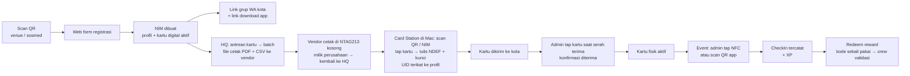

# PATS University — Product Requirements

Status: **showcase prototype**, cakupan penuh visi PRD tim.
Versi dokumen: 1.5 — 16 Oktober 2026.
Sumber: PRD + Visual Flowchart tim (4 bagian) dan keputusan owner 16 Oktober 2026. Jika keduanya berbeda, keputusan owner yang berlaku (lihat [Changelog keputusan](#changelog-keputusan)).

---

## 1. Ringkasan

PATS University adalah program keanggotaan untuk komunitas PATS di banyak kota. Setiap member punya **KTM (Kartu Tanda Mahasiswa)** fisik ber-NFC dengan NIM unik, dipakai untuk absen di event, mengumpulkan XP, menukar reward, dan masuk ke social hub kota asalnya. Regional Admin tiap kota mengelola event dan absensi lewat aplikasi yang sama; HQ mengelola seluruh kota lewat dashboard web.

Produk terdiri dari empat permukaan:

| Permukaan | Platform | Pengguna |
|---|---|---|
| Web registrasi (public) | Web (mobile-first) | Calon member |
| Aplikasi PATS University | Android + iOS, satu app | Member, Regional Admin (role dari akun) |
| Dashboard admin | Web | HQ dan Regional Admin (sebatas satu kota) |
| Card Station | Tool Mac + reader ACR122U | Operator HQ (encode kartu NTAG213) |

Prototype ini dibangun untuk didemokan secara end-to-end: registrasi → kartu → check-in → XP & leaderboard → reward → laporan PR → social hub → roaming → recap. **Prioritas pertama adalah sistem absensi berbasis kartu** (registrasi, kartu NFC, kartu digital fallback, scan admin, riwayat, dasar super admin); fitur lain menyusul (urutan di PLAN.md). Bagian yang berat di back-end dikerjakan pada **demo depth** (lihat [§11](#11-di-luar-cakupan--demo-depth)).

---

## 2. Tujuan & siapa penggunanya

**Tujuan produk**

1. Identitas member yang konsisten lintas kota (KTM + NIM).
2. Absensi event yang terpercaya (admin memverifikasi orangnya, bukan hanya kode).
3. Loyalitas lewat XP dan reward yang tidak bisa diklaim ganda.
4. Komunitas tertutup per kota (social hub) dengan jalur roaming antar kota yang terkontrol.
5. Data operasional venue (traffic recap) terkumpul di satu tempat dan bisa diekspor HQ.

**Pengguna**

| Pengguna | Kebutuhan utama |
|---|---|
| Member | Daftar cepat, punya kartu, absen tanpa ribet, lihat XP & reward, ngobrol di hub kotanya, reservasi tempat |
| Regional Admin (crew kota) | Scan member di pintu, serahkan kartu, validasi reward, isi recap malam itu, kelola channel hub |
| Super Admin / HQ | Lihat semua kota, siapkan batch kartu + file cetak untuk vendor, encode kartu, broadcast event, approve roaming, export data |

---

## 3. Peran

Satu akun = satu role. Role ditentukan server, bukan dipilih di app.

| Role | Permukaan | Ringkasan hak |
|---|---|---|
| `MEMBER` | App | Profil & kartu digital, check-in (discan admin), XP & leaderboard, reward, social hub kota asal, reservasi, request roaming |
| `MEMBER` + flag **PR (promoter)** | App | Badge PR; Claim XP Form Member dan Form PR setelah event, foto struk opsional |
| `REGIONAL_ADMIN` | App + web | Satu kota: event, scan, kartu, redeem, Claim XP, recap, PR, reservasi/DP, moderasi, roaming absensi; tidak menerbitkan timeline |
| `SUPER_ADMIN` | Web dashboard + app (menu HQ) | Kota, admin, event, member, kartu (antrean, batch, file cetak, keputusan encode ulang), broadcast, roaming approval (social hub), recap global (termasuk laporan PR), export, settings. Di app: encode kartu di HP (Phase 2) |

Regional Admin terikat ke **tepat satu kota**. HQ tidak terikat kota. Semua izin admin diperiksa lewat capability. Maksimal lima admin aktif per kota (`regionalAdminLimit`), termasuk saat reaktivasi. Migrasi mengganti enum tanpa mengganti akun atau scope. API profil tetap mengirim alias `LOCAL_ADMIN` untuk kompatibilitas app tester; shared menerima kedua nama. PR adalah flag `isPromoter` yang ditunjuk Regional Admin/HQ.

---

## 4. Perjalanan utama

### 4.1 Registrasi → kartu → check-in → reward

Langkah per langkah:

1. **Scan QR** di venue atau media sosial → membuka web registrasi (`/join?src=<kode kota/sumber>`).
2. **Form registrasi**: nama, tanggal lahir, kota, favorite song & genre, quotes, **email (wajib, identitas login; OTP dikirim ke sini)**, **nomor WhatsApp (wajib, untuk grup WA kota)**. Umur minimum dicek di sini (default 18, setting).
3. **NIM dibuat** otomatis. Profil berstatus `ACTIVE`, kartu fisik berstatus `NOT_PRINTED`. Member langsung bisa login ke app dan memakai **kartu digital** (QR berputar) untuk check-in sampai kartu fisik diterima.
4. **Routing ke grup WA kota**: halaman sukses menampilkan link grup WA kota + link download app. Pesan yang sama dikirim ke email member (SMTP, pengirim yang sama dengan OTP — lihat [§10.6](#106-otp-provider)).
5. **HQ membuat batch** dari halaman **Kartu** di dashboard: antrean member tanpa kartu (`NOT_PRINTED`) per kota → pilih → `CardBatch`. Saat batch dibuat, server membuat `Card` + **token kartu** (ditandatangani, unik) untuk tiap member → status `IN_BATCH`. HQ **mengunduh file cetak**: satu PDF per member (CR80 85,6 × 54 mm + bleed 3 mm, 300 dpi, depan + belakang: **hanya nama, NIM, dan QR berisi token kartu** di atas artwork kartu — song & genre dan quotes tidak dicetak, hanya ada di profil digital `https://patsuniv.znetworks.id/c/<token>`), PDF gabungan satu batch, dan CSV manifest untuk vendor. Render dari template HTML/SVG → PDF.
6. **Cetak di vendor eksternal** — perusahaan menyuplai kartu NTAG213 kosong, vendor mencetak personalisasi di atasnya (**cetak dulu, encode belakangan**). Batch → `SENT_TO_VENDOR`; saat kartu cetakan kembali ke HQ → `RECEIVED_HQ`. Chip masih kosong di tahap ini.
7. **Card Station (HQ, Mac + ACR122U)**: untuk tiap kartu cetakan, operator **mengidentifikasi member dengan memindai QR di kartu lewat kamera Mac atau mengetik NIM**, lalu menempelkan kartu itu ke reader. Tool menulis **NDEF URL** dengan token yang sama dengan QR cetakan (domain final, lihat [§10.7](#107-domain)), mencatat UID, lalu **memproteksi tag dengan password** (NTAG213 PWD/PACK; tulis diproteksi mulai halaman AUTH0, baca tetap terbuka, PROT=0) sehingga payload **hanya bisa ditulis ulang oleh Card Station HQ** — bukan dikunci permanen, bit lock statis/dinamis tidak disentuh. Status kartu menjadi `ENCODED`; binding UID ke profil terjadi di sini. Alasan cetak dulu: nama yang tercetak harus sama dengan isi chip; meng-encode sebelum cetak berisiko tertukar di vendor. Kartu ter-encode dikirim ke kota.
8. **Serah terima**: admin regional membuka menu *Serahkan kartu* dan **tap kartu** ke HP. App membaca NDEF, server mencocokkan token + UID dengan member → status `DELIVERED`, pengiriman terkonfirmasi. Tap ini hanya **konfirmasi penerimaan**; tidak ada binding baru.
9. **Check-in di event**: admin memilih event aktif, member menempelkan kartu ke HP admin (NFC) atau menunjukkan QR app (fallback). Server memvalidasi token NDEF + UID dan mencatat `CheckIn` + XP.
10. **Reward**: member menukar XP di app → `Redemption` dengan kode sekali pakai → crew memasukkan/scan kode → reward diserahkan.

> Menggantikan langkah PDF "Admin tap NFC kosong di venue": kartu dicetak per orang oleh vendor di NTAG213 kosong milik perusahaan, lalu di-encode dan diikat ke member di HQ (Card Station) dengan identifikasi lewat QR cetakan / NIM. Tap pertama oleh admin regional = konfirmasi serah terima.
>
> Bonus showcase: karena isi kartu adalah NDEF URL, member yang menempelkan kartunya sendiri ke iPhone (XS ke atas, background tag reading) mendapat prompt yang membuka profilnya di app (universal link) atau di web jika app belum terpasang.

### 4.2 Event

1. Super Admin atau Regional Admin membuat `Event` (kota, venue, tanggal/jam WIB, flyer, deskripsi, kuota opsional).
2. Push reminder otomatis: H-3, H-1, hari H (jam konfigurasi per kota).
3. Saat event, admin membuka mode **Scan** dan mencatat kehadiran.
4. Jam 12.00 WIB hari berikutnya: push "terima kasih" ke yang hadir, push FOMO ke member kota itu yang tidak hadir.
5. Setelah event, admin mengisi **Traffic Recap** (sofa, table, FDC, pax); sistem menghitung total; HQ bisa export.

### 4.3 Social hub

- Member hanya melihat hub **kota asal** (region-locked).
- Isi hub: **Timeline** (hanya HQ menerbitkan; member membaca dan memberi reaksi), **Live Chat** per channel (teks, voice note, video pendek; mention `@ADMIN` untuk memanggil crew), dan **Reservasi venue**.
- Anti-screenshot: aktif di Android (`FLAG_SECURE`); di iOS hanya terdeteksi dan dicatat (lihat [§10](#10-keamanan--privasi)).

### 4.4 Reservasi venue

- Admin mengatur layout venue (denah sofa/table sebagai grid/koordinat sederhana) per venue.
- Member memilih event + slot (sofa/table) → `Reservation` status `PENDING` → percakapan otomatis terbuka dengan marketing/admin kota → admin `CONFIRMED` / `REJECTED`.
- Satu slot hanya bisa `CONFIRMED` untuk satu reservasi per event. Regional Admin kota event mengonfirmasi; HQ dapat menangani sebagai override.
- Minimum charge numerik per venue, dapat ditimpa per slot; nilai disalin saat pemesanan.
- Satu reservasi `PENDING`/`CONFIRMED` tanpa DP memblokir reservasi baru di semua event. DP yang dicatat admin (nominal, waktu, pencatat) membuka reservasi berikutnya. Pembayaran di luar app.

### 4.5 Roaming antar kota

Dua jenis roaming, masing-masing dengan approver berbeda:

| Jenis | Yang diminta | Approver | Berlaku sampai |
|---|---|---|---|
| `ATTENDANCE` | Absen di event kota lain | Regional Admin kota tujuan | Selesai event (check-in tetap tercatat di kota asal member + kota event) |
| `SOCIAL_HUB` | Akses social hub kota lain | Super Admin (HQ) | 48 jam setelah event tujuan berakhir, lalu otomatis kembali ke hub asal |

Alur: member membuka event kota lain → *Request roaming* → notifikasi ke approver → approve/reject → member dapat push hasilnya. Setelah kedaluwarsa, akses hub lain hilang tanpa aksi manual.

### 4.6 Claim XP setelah event

1. Setelah `endsAt`, setiap member membuka **Claim XP**. Form Member berisi jumlah reservasi; GL hanya jika setting mengizinkan (default mati). PR juga mendapat Form PR: GL pax + jumlah reservasi. Struk opsional pada kedua form.
2. Satu claim per member/event/jenis form, unik di DB. Hanya `PENDING` yang dapat diedit. Member kota event atau yang tercatat hadir dapat mengajukan.
3. Regional Admin kota event meninjau di app/web, di samping recap: approve, reject dengan alasan, atau ubah angka lalu approve. Audit menyimpan aktor/waktu/angka sebelum dan sesudah.
4. Approval memberi XP otomatis sekali: PR = 5 × GL + 25 × reservasi, Member = 25 × reservasi. Tarif configurable. CAS + award key mencegah approval ganda. Reject memberi notifikasi tanpa XP; profil/wallet diperbarui melalui Socket.IO dan push.
5. Ini menggantikan alur admin mengetik recap PR. Laporan/payout fase lama dipertahankan sebagai arsip baca saja.

### 4.7 XP, leaderboard dan live draw

- Registrasi mendapat 100 XP sekali; check-in 50 XP + 25 XP hanya jika sudah ada reservasi `CONFIRMED` untuk event yang sama.
- XP disimpan sebagai ledger, kedaluwarsa 18 bulan kalender sejak diperoleh. Pengeluaran mengonsumsi lot dengan expiry terdekat. Expiry mengurangi sisa lot lewat entri ledger; refund membawa expiry asli, tidak memperpanjang umur XP.
- Leaderboard kota/nasional memakai XP diperoleh, mengecualikan refund, periode kuartal kalender WIB. Seri: XP → waktu mencapai → NIM → ID stabil. Posisi sendiri tetap terlihat.
- Setiap kota, #1 kuartal selesai mendapat satu slot gratis pada event berikutnya, atau event pilihan HQ. Grant unik per kota/periode, pemakaian sekali, expiry akhir kuartal berikutnya (default 3 bulan).
- Live draw: satu hadiah event, lima nama peserta (setting kapasitas), 250 XP/slot, satu slot/member/event, hanya di peak hour dan setelah check-in. Slot dikunci DB, first come first served. Semua slot harus terisi sebelum Regional Admin/HQ menjalankan draw sekali; server memilih secara acak dan mencatat aktor/waktu/semua peserta/pemenang. Socket.IO menampilkan hasil live. XP peserta yang kalah tetap terpakai.

### 4.8 Recap & kontrol HQ

- Regional Admin: dashboard kota (member aktif, kehadiran per event, reward tertukar, recap).
- HQ: semua kota dalam satu tabel, filter periode/kota, **export 1-klik** (CSV/XLSX; PDF di demo depth), broadcast event (flyer + push ke kota terpilih), approval roaming hub, manajemen channel global.

---

## 5. Fitur per peran

### 5.1 Member (app)

| Fitur | Keterangan |
|---|---|
| Login | **Email + kode OTP 6 digit** dikirim ke email (SMTP; provider lihat §10.6), sesi di device; satu akun bisa beberapa device. Nomor WA tidak dipakai untuk login (hanya grup WA kota) |
| Kartu digital | Tampilan KTM digital (nama, NIM, song & genre, quotes — lebih lengkap dari kartu fisik yang hanya nama, NIM, QR) + **QR berputar** (refresh 30–60 detik, ditandatangani server). Dipakai sampai kartu fisik diterima dan sebagai fallback |
| Status kartu fisik | `NOT_PRINTED` → `IN_BATCH` → `SENT_TO_VENDOR` → `RECEIVED_HQ` → `ENCODED` → `DELIVERED` (+ `REVOKED`) ditampilkan di app dengan bahasa manusia ("sedang dicetak", "dalam perjalanan ke kotamu", dst.) |
| Tap kartu sendiri | Tap KTM ke iPhone/Android sendiri → deep link ke profil di app (lewat NDEF URL) |
| Event | Daftar event kota asal + event kota lain (untuk roaming), detail, flyer, reminder |
| Riwayat kehadiran | Daftar `CheckIn` dengan event, waktu, metode |
| XP & milestone | Saldo XP, ledger, progress menuju reward berikutnya |
| Leaderboard | Peringkat kota & nasional per periode, posisi sendiri selalu terlihat |
| Claim XP | Form Member untuk semua; Form PR untuk flag PR. Edit pending, status keputusan dan bonus |
| Reward | Katalog per venue, direct redeem dan kode TTL; slot live draw event |
| Social hub | Timeline, live chat per channel, voice note, video pendek, mention `@ADMIN` |
| Reservasi | Pilih slot dari denah, chat ke marketing, status reservasi |
| Roaming | Request absen kota lain / akses hub kota lain, status request |
| Notifikasi | Pusat notifikasi + pengaturan (reminder, hub, reward) |
| Profil | Edit song/genre/quotes/foto; nama/DOB lewat admin; perubahan kota lewat request dan approval HQ |
| Bahasa | Indonesia / English |

### 5.2 Regional Admin (app, menu Admin)

| Fitur | Keterangan |
|---|---|
| Scan check-in | Pilih event aktif → mode scan: NFC (tap kartu) dan kamera (QR app). Hasil: nama, foto, NIM, status roaming, lalu konfirmasi 1 tap. Manual check-in (cari nama) tersedia dengan alasan wajib |
| Serah terima kartu | Tap kartu → app membaca NDEF → server mencocokkan token + UID → kartu `DELIVERED`; tanpa memilih member manual karena binding sudah dilakukan HQ |
| Lapor kartu hilang / rusak | Tandai `REVOKED` (token lama ditolak permanen); kartu pengganti otomatis masuk antrean cetak HQ |
| Minta encode ulang | Kartu `DELIVERED` rusak tapi chip masih jalan: alasan wajib → HQ setujui/tolak → izin sekali pakai 24 jam untuk meng-encode kartu itu di HP admin yang meminta (password tetap dari server) |
| Validasi reward | Masukkan/scan kode redeem → lihat reward → tandai diserahkan |
| Review Claim XP | Antrean `PENDING` kota event, struk opsional, adjust/approve/reject, bonus otomatis |
| Event kota | Buat/edit event kotanya, lihat kehadiran live saat event |
| Traffic recap | Form per event: sofa, table, FDC, pax, PIC malam itu dan penanggung jawab utama (+ catatan); total dihitung sistem; bisa diedit sampai dikunci HQ |
| Channel hub | Buat/arsip channel, pin post, hapus konten, mute member |
| Reservasi | Daftar reservasi masuk, konfirmasi/tolak, chat dengan member |
| Roaming absensi | Approve/reject request `ATTENDANCE` ke kotanya |
| Dashboard kota | Ringkasan member, kehadiran, reward, recap |

### 5.3 Super Admin / HQ (web)

| Fitur | Keterangan |
|---|---|
| Kota & venue | CRUD kota (kode, zona waktu, link grup WA, copy notifikasi), venue + denah |
| Admin | Undang/nonaktifkan Regional Admin per kota |
| Member | Cari, lihat detail, edit data inti, nonaktifkan |
| Kartu | Halaman **Kartu**: antrean member tanpa kartu (`NOT_PRINTED`) per kota → buat batch (`IN_BATCH`, token kartu dibuat) → **unduh file cetak**: PDF per member (CR80 85,6 × 54 mm + bleed 3 mm, 300 dpi, depan + belakang; hanya nama, NIM, QR token kartu + artwork), PDF gabungan batch, CSV manifest vendor → tandai `SENT_TO_VENDOR` → `RECEIVED_HQ`; progres encode per batch; daftar kartu belum `DELIVERED`. Render HTML/SVG template → PDF |
| Card Station (tool Mac) | Tool kecil di Mac HQ dengan reader **ACR122U**, dipakai setelah kartu cetakan kembali dari vendor: identifikasi member dengan **scan QR cetakan (kamera Mac) atau ketik NIM** → tempel kartu → tulis NDEF URL bertoken (token sama dengan QR) ke **NTAG213** → catat UID → proteksi tulis dengan password (PWD/PACK, tanpa lock permanen) → status `ENCODED`. Bisa **re-encode** kartu (password diturunkan dari kunci server + UID), misalnya memakai ulang kartu untuk member lain atau mengganti token. Menyimpan hasil ke server lewat API dengan kredensial super admin |
| Revoke & rebind | Revoke token kartu hilang, encode kartu pengganti |
| Event | Semua kota; buat event lintas kota; broadcast flyer + push ke kota terpilih |
| Roaming | Approve/reject request `SOCIAL_HUB`; lihat semua request |
| Reward & XP | Katalog reward, nilai XP, aturan spin, kuota — semua sebagai setting |
| Recap global | Tabel recap per event/kota (termasuk laporan PR + struk), kunci recap, export 1-klik |
| Leaderboard | Lihat leaderboard kota/nasional per periode, atur periode & jumlah teratas |
| PR / Claim XP | Penunjukan PR, review claim PR dan member, audit keputusan |
| Export | Member, check-in, XP ledger, leaderboard, redemption, laporan PR, recap → CSV/XLSX |
| Audit | Log aksi admin (bind/revoke kartu, manual check-in, approval) |
| Settings | Umur minimum, XP per check-in, rotasi QR, jendela roaming, waktu push per kota |

#### Dashboard super admin — daftar halaman

Urutan menu di dashboard. Halaman 1–6 adalah bagian dari **fokus sistem absensi kartu (Phase 0–2)**; sisanya menyusul di fase berikutnya.

| # | Halaman | Isi | Fase |
|---|---|---|---|
| 1 | Ringkasan | Angka per kota: member aktif, kartu per status, event terdekat, check-in hari ini | 0–2 |
| 2 | Member | Cari, detail, edit data inti, nonaktifkan, status kartu | 0–2 |
| 3 | Kartu | Antrean `NOT_PRINTED`, batch, unduh file cetak (PDF per member, PDF batch, CSV manifest), status vendor → encode → kirim, kartu belum `DELIVERED`, revoke | 0–2 |
| 4 | Kota & venue | CRUD kota (kode, zona waktu, link grup WA, copy notifikasi), venue + denah | 0–2 |
| 5 | Regional Admin | Undang/nonaktifkan Regional Admin per kota | 0–2 |
| 6 | Event | Semua kota; buat/edit event, jendela check-in, daftar hadir + metode check-in | 0–2 |
| 7 | Broadcast | Flyer + push ke kota terpilih | Lanjut |
| 8 | Reward & XP | Katalog reward, nilai XP, aturan spin, leaderboard | Lanjut |
| 9 | Roaming | Approve/reject `SOCIAL_HUB`, lihat semua request | Lanjut |
| 10 | Rekap traffic | Recap per event/kota, laporan PR + struk, kunci, export | Lanjut |
| 11 | Pengaturan | Semua key §9 | 0–2 (key absensi) / Lanjut (key XP, roaming) |
| 12 | Audit log | Aksi admin: bind/revoke kartu, manual check-in, approval, export | 0–2 (dasar) / Lanjut (lengkap) |

### 5.4 Standar desain

App dan dashboard harus **bersih, setara Notion/Linear, dan memakai bahasa visual yang sama dengan NEXUS** (produk owner yang sudah jalan):

- Warna netral yang tenang, **satu warna aksen**, hierarki jelas (judul → isi → meta), jarak lega; tidak ada teks terpotong; ikon dari satu set yang konsisten.
- Setiap layar punya **empty state** (kenapa kosong + langkah berikutnya + tombol), loading state, dan error state dengan aksi.
- Format angka `3.800`, mata uang `Rp 6.000.000`, tanggal `14 Oct` (helper tunggal di `packages/shared`, lihat PLAN.md §6).
- **Design token** (warna, skala tipografi, radius, spasi) didefinisikan **sekali** di `packages/shared` dan dipakai oleh app Expo maupun dashboard web; tidak ada nilai warna/spasi hardcode di komponen.
- Sebelum layar pertama dibangun, tim menurunkan **`DESIGN.md`** untuk pats-univ (memakai ulang konvensi token NEXUS bila masuk akal), dan setiap layar diperiksa terhadap **checklist craft Impeccable** sebelum masuk `dev`.

---

## 6. Aturan

### 6.1 Check-in

1. Check-in hanya dilakukan **oleh admin** (crew yang melihat orangnya). Self check-in + GPS tidak ada di prototype ini; disiapkan sebagai opsi lanjutan untuk event tanpa crew.
2. Urutan metode: **`NFC`** (kartu fisik) → **`APP_QR`** (QR berputar di app, fallback) → **`MANUAL`** (cari nama, alasan wajib). Metode dicatat di tiap `CheckIn` agar HQ bisa mengaudit pemakaian fallback.
3. Validasi server untuk `NFC`: app admin membaca **NDEF URL** dan UID; server memverifikasi tanda tangan token, token milik kartu `DELIVERED`, **UID cocok dengan UID yang dicatat saat encode**, member aktif. UID saja (tanpa token sah) ditolak. Untuk `APP_QR`: token ditandatangani server, belum kedaluwarsa (TTL 30–60 detik), belum pernah dipakai (nonce). Untuk keduanya: event sedang `OPEN` dan admin adalah admin kota event tersebut.
4. **Satu member satu check-in per event.** Tap kedua ditolak dengan pesan "sudah check-in".
5. Member dari kota lain hanya bisa check-in jika ada `RoamingRequest` tipe `ATTENDANCE` berstatus `APPROVED` untuk event itu.
6. Jendela check-in: dari `checkInOpensAt` sampai `checkInClosesAt` event (default: 1 jam sebelum mulai sampai event berakhir; setting).

### 6.2 XP, reward dan draw — diputuskan 16 Oktober

| Aturan | Default / keputusan |
|---|---|
| Welcome / check-in / reservasi confirmed | 100 / 50 / +25 XP |
| Katalog redeem | Per venue; harga dan stok ditetapkan admin |
| Live draw | 250 XP per slot; 5 nama; satu slot/member/event; peak hour per event |
| Hadiah draw | Satu hadiah event; dipilih admin; hasil server sekali, audit + realtime |
| XP kedaluwarsa | 18 bulan sejak diperoleh; hanya sisa yang belum dipakai |
| Kartu pengganti | Rp 100.000, pembayaran dicatat di luar app, tanpa batas penggantian |

Semua angka operasional tersedia sebagai setting dashboard/field event/venue. Saldo adalah SUM ledger setelah expiry. Draw menggantikan wheel pribadi berbobot; katalog spin lama tidak aktif, riwayat transaksi lama tetap ada.

### 6.3 Redeem — kode sekali pakai

1. Member menekan *Redeem* → server mengurangi XP dan membuat `Redemption` berstatus `ISSUED` dengan **kode 6 karakter** + QR, berlaku 15 menit (setting).
2. Crew memasukkan/scan kode → server mengecek: kode ada, `ISSUED`, belum kedaluwarsa, event/kota cocok → status `FULFILLED` + admin yang memvalidasi.
3. Kode yang sudah `FULFILLED` atau `EXPIRED` ditolak. Kode kedaluwarsa mengembalikan XP otomatis dengan expiry asli; bila sudah lewat expiry, XP langsung tidak dapat dibelanjakan.
4. Satu reward tidak bisa diklaim dua kali karena transisi status dilakukan atomik di server.

### 6.4 Umur

- Tanggal lahir **wajib** saat registrasi.
- Umur minimum = setting `minAge` (default **18**, belum final). Dicek saat registrasi; yang tidak memenuhi ditolak dengan pesan jelas dan data tidak disimpan.

### 6.5 Roaming

- `ATTENDANCE`: disetujui Regional Admin kota tujuan; berlaku untuk satu event.
- `SOCIAL_HUB`: disetujui HQ; akses hub tujuan **kedaluwarsa 48 jam** (setting) setelah event tujuan berakhir. Setelah itu akses kembali ke hub asal otomatis.
- Request tanpa keputusan sampai event dimulai menjadi `EXPIRED`.
- Satu member maksimum satu request aktif per event per jenis.

### 6.6 Leaderboard

Kuartal kalender WIB, kota dan nasional; tampilan default 50 teratas. Pengeluaran dan expiry tidak mengurangi XP peringkat yang diperoleh pada periode, refund tidak menambah peringkat. Tie-break mengikuti §4.7. Hadiah satu slot gratis untuk #1 **setiap kota**, bukan pemenang nasional; tidak dapat ditukar uang dan tidak berlaku setelah expiry.

### 6.7 Claim XP

Aturan final adalah §4.6 (addendum yang menggantikan OPEN-3). PR ditunjuk Regional Admin, bukan mengajukan sendiri. Claim per jenis form bersifat unik permanen; reject tidak memberi XP dan tidak membuka claim baru untuk kombinasi yang sama. Foto bukti privat dan opsional. Alur payout uang lama tidak dipakai untuk claim baru.

### 6.8 NIM — usulan format

Format diusulkan (belum final): **`<kode kota 3 huruf><yy><5 digit urut>`**, contoh `JKT2600042` = Jakarta, registrasi 2026, urutan ke-42 di kota itu tahun itu. Urutan di-reset per kota per tahun. NIM tidak berubah walau member pindah kota.

---

## 7. Data utama

Nama entitas dan field inti (teknis detail ada di PLAN.md / schema).

| Entitas | Field inti | Catatan |
|---|---|---|
| `User` | id, email (unik, identitas login), phone (wajib, E.164, untuk grup WA kota), role, cityId (admin), status | Akun login lewat email + OTP; member & admin sama-sama `User` |
| `Member` | id, userId, nim, fullName, dateOfBirth, cityId (asal), favoriteSong, favoriteGenre, quotes, photoUrl, isPromoter, promoterSince, joinedAt, status | Satu `User` role `MEMBER` = satu `Member` |
| `Card` | id, memberId, nfcUid (unik, nullable, diisi saat encode), chipType (NTAG213/215/216), lease (stasiun yang sedang memegang kartu, 3 menit), encodedStation, replacesCardId, ndefToken (unik, ditandatangani, dibuat saat masuk batch = isi QR cetakan), status (`NOT_PRINTED`/`IN_BATCH`/`SENT_TO_VENDOR`/`RECEIVED_HQ`/`ENCODED`/`DELIVERED`/`REVOKED`), batchId, printFileUrl, encodedAt, encodedByUserId, lockedAt, deliveredAt, deliveredByAdminId, revokedAt, revokeReason | Member bisa punya banyak `Card` (riwayat), hanya satu `DELIVERED`. Password tag tidak disimpan per kartu; diturunkan dari kunci server + UID |
| `ReencodeRequest` | id, cardId, requestedById, reason, status (`PENDING`/`APPROVED`/`REJECTED`/`USED`/`EXPIRED`), decidedById, decisionNote, grantExpiresAt, usedAt | Satu permintaan terbuka per kartu |
| `CardBatch` | id, cityId, number (label `JKT-3`), status (`EXPORTED`/`SENT_TO_VENDOR`/`RECEIVED_HQ`/`ENCODING`/`SHIPPED_TO_CITY`/`DONE`), cardCount, encodedCount, exportedAt, sentToVendorAt, receivedHqAt, shippedToCityAt, batchPdfUrl, manifestCsvUrl, vendorNote | Satu batch = satu kali cetak vendor + encode per kota; file per member ada di `Card.printFileUrl` |
| `City` | id, code (3 huruf), name, timezone (default `Asia/Jakarta`), waGroupUrl, notificationCopy (JSON), settings (JSON) | Copy push per kota ada di sini |
| `Venue` | id, cityId, name, address, lat, lng, layout (JSON: slot sofa/table + koordinat) | Denah untuk reservasi |
| `Event` | id, cityId, venueId, title, description, flyerUrl, startsAt, endsAt, checkInOpensAt, checkInClosesAt, status (`DRAFT`/`PUBLISHED`/`OPEN`/`CLOSED`), maxSpinsPerMember, createdById | Waktu disimpan UTC, ditampilkan WIB |
| `CheckIn` | id, eventId, memberId, method (`NFC`/`APP_QR`/`MANUAL`), cardId, adminId, roamingRequestId, manualReason, checkedInAt | Unik (eventId, memberId) |
| `XpLedger` | id, memberId, delta, reason (`CHECK_IN`/`REDEEM`/`SPIN`/`REFUND`/`PROMOTER_BONUS`/`ADJUST`), refType, refId, createdAt | Saldo = SUM(delta); expiry/awardKey/allocations; leaderboard positif selain REFUND |
| `LeaderboardSnapshot` | id, scope (`CITY`/`NATIONAL`), cityId, periodStart, periodEnd, entries (JSON: rank, memberId, xp) | Dihitung cron tiap jam + saat periode tutup; query live untuk posisi sendiri |
| `PromoterReport` (arsip) | id, memberId (PR), eventId, cityId, guestCount, guests (JSON: nama/nomor opsional), receiptUrl (privat), receiptAmount (opsional), status (`SUBMITTED`/`VALIDATED`/`REJECTED`), bonusKind (`XP`/`CASH`), bonusValue, reviewedById, reviewedAt, rejectReason | Unik (memberId, eventId) |
| `PromoterPayout` (arsip) | id, promoterReportId, memberId, amount, status (`PENDING`/`PAID`), paidAt, paidById | Riwayat Phase 3; tidak ada payout baru |
| `Reward` | id, type (`DIRECT`/`SPIN_PRIZE`), name, description, xpCost, cityId (nullable = global), stock (nullable), active, spinWeight | Baru hanya DIRECT dengan venueId; bobot/type spin untuk arsip |
| `Redemption` | id, memberId, rewardId, eventId, kind (`DIRECT`/`SPIN`), code (unik), status (`ISSUED`/`FULFILLED`/`EXPIRED`/`CANCELLED`), issuedAt, expiresAt, fulfilledAt, fulfilledByAdminId | Kode sekali pakai |
| `Channel` | id, cityId, name, kind (`TIMELINE`/`CHAT`), visibility, archived | Hub per kota |
| `Post` | id, channelId, authorId, body, mediaUrls, pinned, createdAt, deletedAt | Timeline |
| `Message` | id, channelId (atau conversationId), senderId, body, mediaUrl, mediaType (`TEXT`/`VOICE`/`VIDEO`/`IMAGE`), mentionsAdmin, createdAt | Live chat & chat reservasi |
| `Conversation` | id, kind (`RESERVATION`/`SUPPORT`), cityId, memberId, reservationId | Chat 1:1 member ↔ admin |
| `Reservation` | id, eventId, venueId, memberId, slotCode, pax, status (`PENDING`/`CONFIRMED`/`REJECTED`/`CANCELLED`), note, conversationId | Unik (eventId, slotCode) saat `CONFIRMED` |
| `RoamingRequest` | id, memberId, eventId, targetCityId, type (`ATTENDANCE`/`SOCIAL_HUB`), status (`PENDING`/`APPROVED`/`REJECTED`/`EXPIRED`), decidedById, decidedAt, accessExpiresAt | `accessExpiresAt` = endsAt event + 48 jam |
| `TrafficRecap` | id, eventId, cityId, sofaCount, tableCount, fdcCount, paxCount, revenueSofa, revenueTable, revenueFdc, total, note, submittedById, lockedAt | Total dihitung server |
| `XpClaim` | memberId, eventId, formType, guestCount, reservationCount, receiptUrl, notes, status, bonusValue, reviewer/waktu/alasan | Unik member/event/form, CAS pending |
| `DrawEntry` | eventId, memberId, position, xpSpent, freeCreditId | Unik event/member dan event/posisi |
| `FreeDrawCredit` | cityId, memberId, periodStart/end, eventId, expiresAt, usedAt | Unik kota/kuartal |
| `RegionChangeRequest` | memberId, fromCityId, toCityId, reason, status, decidedById, decidedAt | Satu pending per member |
| `PostReaction` | postId, userId | Satu reaksi/member/post |
| `Notification` | id, userId, kind, title, body, data (JSON), sentAt, readAt | Pusat notifikasi + log push |
| `Device` | id, userId, platform, pushToken, appVersion, lastSeenAt | Target push |
| `AuditLog` | id, actorId, action, targetType, targetId, meta, createdAt | Bind/revoke, manual check-in, approval, lock recap |
| `Setting` | key, value (JSON), scope (`GLOBAL`/`CITY`), cityId | XP, umur, TTL, jendela roaming, jam push |
| `OtpCode` | id, userId / email, codeHash, purpose (`LOGIN`/`REGISTER`), provider, expiresAt, attempts, consumedAt | OTP per email; provider yang mengirim dicatat (lihat §10.6) |

---

## 8. Notifikasi

**T9 menunggu sumber copy:** tabel jawaban menyebut copy final tetapi tidak memuat lima kalimat verbatim. Copy berikut adalah fallback lama, bukan copy final tim. Isi override ID verbatim dan terjemahan EN setelah HQ mengirim teks; `{city}` sudah diisi otomatis.

Semua waktu dalam **WIB** (`Asia/Jakarta`) kecuali kota diset zona lain. Copy push **dapat diubah per kota** oleh HQ (`City.notificationCopy`), dengan placeholder `{name}`, `{event}`, `{venue}`, `{time}`, `{city}`.

| Pemicu | Penerima | Waktu | Copy default (ID) |
|---|---|---|---|
| Event dipublish / broadcast | Member kota tujuan | Saat broadcast | "{event} — {time} di {venue}. Sampai ketemu!" |
| Reminder H-3 | Member kota event | 10.00 WIB | "3 hari lagi: {event}." |
| Reminder H-1 | Member kota event | 10.00 WIB | "Besok: {event} di {venue}." |
| Reminder hari H | Member kota event | 10.00 WIB | "Malam ini: {event}. Bawa KTM-mu." |
| Terima kasih (hadir) | Member yang check-in | H+1 12.00 WIB | "Thank you udah dateng semalem, {name}. +{xp} XP masuk." |
| FOMO (absen) | Member kota event yang tidak check-in | H+1 12.00 WIB | "Kamu kenapa semalem ga dateng, {name}? Cek event berikutnya." |
| Check-in berhasil | Member | Realtime | "Check-in {event} tercatat. +{xp} XP." |
| Redeem dibuat / kedaluwarsa | Member | Realtime | Kode + sisa waktu |
| Roaming diputuskan | Member | Realtime | Disetujui / ditolak |
| Claim XP diputuskan | Pengaju (PR/member) | Realtime | Approved (+XP) / rejected (alasan); wallet room privat |
| Leaderboard periode tutup | Member (opsional) | Awal periode | Peringkat akhir periode lalu |
| Request roaming masuk | Approver (admin / HQ) | Realtime | Nama, kota asal, event |
| Reservasi diputuskan | Member | Realtime | Dikonfirmasi / ditolak |
| Mention `@ADMIN` | Admin kota | Realtime | Cuplikan pesan |
| Kartu siap diambil | Member | Saat batch `SHIPPED_TO_CITY` | "KTM kamu sudah sampai di {city}. Ambil di event berikutnya." |

Pengiriman: Expo Push → APNs (iOS) / FCM (Android). Setiap push juga tersimpan sebagai `Notification` agar terlihat di pusat notifikasi. Member bisa menonaktifkan kategori tertentu kecuali notifikasi keamanan akun.

---

## 9. Pengaturan (setting) yang wajib bisa diubah tanpa rilis

| Key | Scope | Default |
|---|---|---|
| `minAge` | GLOBAL | 18 (TBD) |
| `welcomeBonusXp` | GLOBAL | 100 |
| `xpPerCheckIn` / `reservationBonusXp` | GLOBAL / CITY | 50 / 25 |
| `xpExpiryMonths` | GLOBAL | 18 |
| `spinCostXp` | GLOBAL | 250 |
| `maxSpinsPerEvent` / `drawSlots` | GLOBAL / EVENT | 1 (0 menutup entry) / 5 |
| `freeDrawExpiryMonths` | GLOBAL | 3 |
| `regionalAdminLimit` | GLOBAL / CITY | 5 |
| `cardReplacementFee` | GLOBAL | 100000 |
| `redeemCodeTtlMinutes` | GLOBAL | 15 |
| `appQrTtlSeconds` | GLOBAL | 45 (rentang 30–60) |
| `roamingHubExpiryHours` | GLOBAL | 48 |
| `roamingMaxPerMonth` | GLOBAL | 0 = tanpa batas, per jenis per bulan UTC |
| `hubTimelinePosting` | GLOBAL / CITY | `HQ`; timeline selalu HQ-only |
| `hubHistoryDays` | GLOBAL | 30 hari |
| `hubMediaMaxSeconds` / `hubMediaMaxMb` | GLOBAL | 60 detik / 25 MB (TBD) |
| `reservationApprover` | GLOBAL / CITY | `REGIONAL_ADMIN` |
| `leaderboardPeriod` | GLOBAL | `QUARTERLY` |
| `leaderboardTopN` | GLOBAL | 50 |
| `promoterBonusKind` | GLOBAL | `XP` |
| `promoterBonusPerGuestXp` / `promoterBonusPerReservationXp` | GLOBAL / CITY | 5 / 25 |
| `memberBonusPerReservationXp` / `memberBonusPerGuestXp` | GLOBAL / CITY | 25 / 5 |
| `memberClaimAllowGl` | GLOBAL | 0 (reservasi saja) |
| `checkInOpensBeforeMinutes` | GLOBAL / EVENT | 60 |
| `reminderTime` | CITY | 10:00 |
| `followUpTime` | CITY | 12:00 |
| `notificationCopy.*` | CITY | lihat §8 |

---

## 10. Keamanan & privasi

### 10.1 Credential & check-in

- **Credential utama = kartu NFC fisik** (NTAG213 PVC, sudah dibeli owner). HP admin adalah reader di lapangan (Core NFC di iPhone, NFC di Android); reader **ACR122U** hanya dipakai di HQ untuk encode.
- **Isi kartu = NDEF URL bertanda tangan** (`https://patsuniv.znetworks.id/c/<token>`, domain final — lihat §10.7), ditulis di HQ lalu tag **diproteksi password** (NTAG213 PWD/PACK: tulis diproteksi mulai halaman AUTH0, PROT=0 sehingga baca tetap terbuka; **bukan lock permanen** — bit lock statis/dinamis tidak disetel) sehingga **hanya bisa ditulis ulang oleh Card Station HQ**, yang menurunkan password dari kunci server + UID (misalnya memakai ulang kartu untuk member lain atau mengganti token). Server memverifikasi tanda tangan token **dan** mencocokkan UID yang dibaca dengan UID yang dicatat saat encode.
- **Kloning UID saja tidak cukup**: penyerang juga butuh token sah untuk UID itu. Yang masih mungkin: menyalin token + mengemulasi UID dengan alat khusus (magic card). Ini diterima untuk prototype karena admin melihat orangnya. Upgrade berikutnya bila perlu: chip dengan kriptografi per tap (NTAG 424 DNA, SUN message) sehingga payload berubah tiap tap.
- **Kartu digital** adalah QR berputar: payload `{memberId, nonce, exp}` ditandatangani server (HMAC/Ed25519), TTL 30–60 detik, nonce sekali pakai. Screenshot QR tidak berguna setelah TTL habis.
- **Faktor kuat = crew yang melihat orangnya.** Karena itu self check-in + GPS tidak dipakai: QR statis bisa difoto dan GPS bisa dipalsukan.
- Setiap check-in mencatat metode, admin, dan kartu. Manual check-in wajib alasan dan masuk `AuditLog`.
- Kartu hilang: `REVOKED` → token + UID lama ditolak permanen → HQ encode kartu pengganti (token baru) di Card Station.
- Password tag NTAG213 diturunkan dari kunci rahasia server + UID (tidak disimpan per kartu). Password NTAG213 hanya 32-bit dan melindungi dari penulisan ulang, bukan dari pembacaan; kerahasiaan ada di tanda tangan token, bukan di password tag.

### 10.2 Reward

- Kode redeem sekali pakai, transisi status atomik di server, kedaluwarsa otomatis.
- Hasil spin dihitung server dengan bobot dari setting; app hanya menampilkan animasi.

### 10.3 Data pribadi

- Data yang disimpan: nama, tanggal lahir, kota, email, nomor WA, foto, song/genre/quotes, riwayat kehadiran, riwayat XP/redeem, konten hub.
- Tanggal lahir hanya dipakai untuk cek umur dan tidak ditampilkan ke member lain; di kartu fisik hanya nama, NIM, dan QR (song & genre, quotes hanya di profil digital).
- Export data hanya oleh HQ, tercatat di `AuditLog`.
- **Foto struk laporan PR** adalah data finansial/pribadi: disimpan di bucket privat, diakses lewat URL bertanda tangan berumur pendek, hanya oleh PR pemilik laporan, Regional Admin kota event, dan Super Admin. Tidak pernah tampil di hub atau ke member lain. Nama/nomor tamu (opsional) diperlakukan sama.
- Leaderboard hanya menampilkan nama tampilan, foto, kota, dan XP; tidak ada data lain.
- Member bisa meminta penonaktifan akun; data absensi/recap tetap (agregat), data profil dianonimkan.
- Perlu halaman kebijakan privasi + persetujuan saat registrasi (konten dari tim).

### 10.4 Anti-screenshot

- **Android**: dapat dipaksa dengan `FLAG_SECURE` pada layar hub — screenshot dan screen recording diblokir sistem.
- **iOS**: tidak bisa dicegah; hanya **terdeteksi** (`UIApplication.userDidTakeScreenshotNotification` dan `isCaptured`). App mencatat kejadian, menampilkan peringatan, dan admin bisa melihat jumlah pelanggaran per member. Dokumen ini menyatakan keterbatasan itu secara eksplisit ke tim.

### 10.5 Akun & akses

- Login **email + OTP** (provider lihat §10.6); sesi dengan refresh token; logout jarak jauh dari dashboard.
- Regional Admin hanya bisa mengakses data kotanya; dicek di server pada tiap endpoint.
- Rate limit pada registrasi, OTP (per email dan per IP), dan endpoint scan.

### 10.6 OTP provider

Login member dan admin memakai **email + kode OTP 6 digit** (TTL 5 menit, maksimum 5 percobaan, tabel `OtpCode`). **Pengirim OTP adalah provider yang bisa diganti** lewat satu setting env `OTP_PROVIDER`; logika buat/verifikasi kode tidak berubah apa pun providernya, hanya cara kode sampai ke member yang berbeda. Provider **saat ini = `email`**; provider berbasis nomor HP disiapkan sebagai jalur pindah di kemudian hari (identitas login ikut pindah ke nomor HP bila itu dipilih).

| Mode | `OTP_PROVIDER` | Kanal | Cara kerja | Status |
|---|---|---|---|---|
| **Email** | `email` | Email | Kode dikirim lewat **SMTP** (akun email PATS / relay yang sudah ada), template EN/ID, rate limit per email dan per IP | **Dipakai sekarang** (Phase 0 ke atas) |
| **Demo** | `demo` | Layar | OTP **ditampilkan di layar** dan dikembalikan di respons API; tidak ada gateway sama sekali | Showcase, akun demo, uji otomatis |
| Prototype HP | `whatsapp-bridge` | WhatsApp | Bridge WhatsApp kecil yang berdiri sendiri, dipisahkan dari setup Hermes milik owner: **Baileys** (protokol WhatsApp Web, **tidak resmi**), nomor WA khusus untuk PATS, rate limit per nomor tujuan, **fallback OTP di layar** bila bridge mati | Jalur pindah nanti; hanya uji internal |
| Produksi HP | `cloud-api` | WhatsApp + SMS | **WhatsApp Cloud API resmi** lewat BSP, **fallback SMS** bila WA gagal. Alternatif tercepat yang sudah "nyata": **Firebase Phone Auth** | Jalur pindah nanti; butuh T17 |

Risiko mode `whatsapp-bridge` yang harus diterima secara sadar bila jalur HP diaktifkan:

- Baileys bukan API resmi Meta → **nomor bisa diblokir** sewaktu-waktu tanpa pemberitahuan; nomor PATS harus nomor khusus, bukan nomor pribadi/operasional.
- **Sesi bisa putus** dan butuh scan QR ulang (pernah terjadi pada setup Hermes owner, Juli 2026). Karena itu fallback OTP di layar tetap ada di mode ini.
- Mode ini tidak boleh dipakai untuk rilis ke member; batas pemakaiannya hanya uji internal.

Bila kelak pindah ke OTP HP untuk produksi, **verifikasi Meta Business harus dimulai jauh sebelumnya** karena memakan waktu berminggu-minggu (aksi owner, lihat T17 §12). Risiko mode `email`: kode masuk spam / terlambat — mitigasi: domain pengirim dengan SPF/DKIM, tombol kirim ulang dengan jeda, dan `demo` untuk showcase.

### 10.7 Domain

Domain produk **final: `patsuniv.znetworks.id`** (web registrasi `/join`, dashboard HQ, API, dan URL kartu). URL kartu = **`https://patsuniv.znetworks.id/c/<token>`**.

- URL ini **permanen dalam praktik**: tertulis di NDEF NTAG213 dan kartu yang sudah beredar tidak bisa diperbarui dari jauh (hanya Card Station HQ yang bisa menulis ulang, satu per satu); subdomain `patsuniv.znetworks.id` harus **dipertahankan selamanya**. Bila kelak ada domain khusus, `patsuniv.znetworks.id` tetap hidup dan mengarahkan (redirect) ke domain baru.
- **Universal Links (iOS)** dan **App Links (Android)** disajikan dari domain ini: `/.well-known/apple-app-site-association` (AASA) dan `/.well-known/assetlinks.json`.
- DNS + tunnel untuk domain ini dipasang oleh sesi server utama owner di akhir Phase 0 (lihat PLAN.md).

---

## 11. Di luar cakupan / demo depth

Prototype mencakup seluruh visi PRD, tetapi beberapa bagian dibangun pada **demo depth**: cukup untuk didemokan end-to-end dengan data nyata, belum siap untuk beban produksi.

| Bagian | Kedalaman prototype | Yang belum |
|---|---|---|
| Live chat | Realtime di satu channel per kota, teks + voice note + video pendek, riwayat 30 hari | Skala besar, moderasi otomatis, typing indicator, read receipt |
| Voice note & video | Upload ke object storage, pemutaran dasar, batas 60 detik / 25 MB | Transcoding, thumbnail otomatis, streaming adaptif |
| Anti-screenshot | Android diblokir, iOS dideteksi + dicatat | Watermark dinamis, pemblokiran iOS (tidak mungkin) |
| Reservasi venue | Denah grid sederhana per venue, chat ke admin | Denah vektor interaktif, pembayaran DP |
| Live draw | Lima nama, sekali per event, server random, audit, realtime | Pengiriman hadiah fisik ditangani crew |
| Export PDF | CSV/XLSX nyata; PDF berupa cetak dari tampilan web | Template PDF resmi |
| Card Station | Tool CLI kecil di Mac (Rust), satu kartu per aksi, identifikasi via QR cetakan / NIM, hasil langsung ke server | Antrian batch otomatis |
| File cetak kartu | PDF per member + PDF batch + CSV manifest dari template HTML/SVG (CR80 + bleed 3 mm, 300 dpi) | Manajemen warna/ICC pracetak, preflight otomatis sesuai spek vendor, portal vendor |
| Leaderboard | Snapshot per jam + posisi sendiri live | Hadiah peringkat, histori periode panjang |
| Claim XP | PR/member, struk opsional, review regional, audit, XP otomatis | OCR struk dan pembayaran uang nyata |
| Grup WA | Link ke grup kota (manual) | Integrasi WhatsApp API |
| OTP | Mode `email` (SMTP) dan `demo` (di layar) | OTP via nomor HP: `whatsapp-bridge` (Baileys, tidak resmi) lalu WhatsApp Cloud API resmi via BSP + fallback SMS (butuh verifikasi Meta Business, T17) |
| Push | Expo Push nyata ke device demo | Segmentasi lanjutan, A/B copy |
| Self check-in + GPS | Tidak ada | Opsi lanjutan untuk event tanpa crew |
| Pembayaran, tiket berbayar, merchandise | Tidak ada | — |
| Integrasi POS venue untuk recap | Tidak ada (input manual) | — |

---

## 12. Keputusan tim dan dependensi tersisa

| ID | Keputusan / status 16 Oktober 2026 |
|---|---|
| T1 | 100 XP welcome sekali, 50 check-in, +25 confirmed reservation |
| T2 | Reward per venue; katalog aktual diisi operasional |
| T3 / T4 | Live draw lima nama, 250 XP, sekali/member/event saat peak hour; bukan wheel pribadi |
| T5 | Tetap 18 sampai keputusan umur final |
| T6 | Format NIM tetap `<kota><yy><5 digit>`; belum ada pengganti |
| T7 | Launch JKT Jakarta + JOG Jogja; BDG/SBY hanya demo |
| T8 / T8b | Vendor cetak dahulu, HQ encode; satu template swappable |
| T8c | Artwork HQ belum diterima; placeholder di `apps/web/card-templates/placeholder`, `CARD_TEMPLATE_DIR` untuk penggantian |
| T9 | `{city}` siap; lima teks ID verbatim belum disertakan pada sumber, terjemahan EN menunggu teks tersebut |
| T10 | Timeline hanya HQ; member baca/reaksi |
| T11 | Recap menambah PIC malam itu dan penanggung jawab utama |
| T12 | Legal HQ menulis; placeholder tetap sampai teks diterima |
| T13 | Brand tetap PATS University |
| T14 / OPEN-4 | Kuartalan, #1 per kota satu slot gratis, event berikutnya/pilihan HQ, expiry akhir kuartal berikutnya |
| T15 / T16 / OPEN-3 terbaru | PR ditunjuk Regional Admin. Claim XP PR dan member diajukan di app; admin review/adjust/approve/reject. PR 5×GL+25×reservasi, member 25×reservasi |
| T17 | Email OTP tetap; WA/SMS belum diminta |
| S1 / OPEN-1 | Regional Admin = satu kota; migrasi menjaga akun/scope, alias lama diterima |
| S2 / S3 | Dashboard regional scoped; maksimum 5 admin aktif, setting |
| S4 | Penggantian kartu Rp100.000, paid/unpaid/pencatat/waktu, tanpa batas |
| S5 | XP expiry 18 bulan, ledger expiry idempoten |
| S6 | Request pindah kota → HQ approve/reject; NIM/kartu tetap |
| S7 / S8 | Regional Admin konfirmasi, minimum charge venue/slot; satu unpaid lintas event sampai DP dicatat |
| S9 | Roaming hub 48 jam, tanpa batas jumlah default |
| S10 | Keluar: anonimisasi profil, revoke sesi/device, pertahankan data kehadiran/ledger |

---

## 13. Changelog keputusan

### 16 Oktober 2026 — Phase 5, keputusan tim + addendum Claim XP

Aturan aktif di §3–§12 menggantikan default historis Phase 3/4: JKT/JOG, Regional Admin satu kota dan dashboard, welcome/reservation XP, venue reward, live draw lima nama, kuartal/free slot, expiry 18 bulan, fee kartu, perpindahan region, DP lintas event, HQ-only timeline, PIC/accountable. Addendum terakhir mengganti admin-entry PR recap dengan Claim XP PR/member yang direview regional. Copy push verbatim, artwork, dan legal masih memerlukan bahan HQ. Entri changelog di bawah mencatat riwayat, bukan aturan operasional saat ini.

### 16 Oktober 2026 — keputusan owner (mengganti PDF jika berbeda)

1. **Admin yang scan member**, bukan self check-in. Alasan: QR statis bisa difoto, GPS bisa dipalsukan; crew yang melihat orang adalah faktor kuat. Self check-in + GPS menjadi opsi lanjutan untuk event tanpa crew.
2. **Credential utama = kartu NFC fisik.** Kartu digital (QR berputar 30–60 detik, ditandatangani server) hanya dipakai sampai kartu fisik diterima dan sebagai fallback. HP admin = reader di lapangan; tanpa hardware reader terpisah di venue (reader ACR122U hanya di HQ, lihat poin 9).
3. **Kartu dicetak per orang** (nama, NIM, song, quotes, QR, chip NFC). → Isi cetakan dikoreksi di poin 18: hanya nama, NIM, QR. Mengganti langkah "kartu kosong di venue" di PDF. Kartu hilang: revoke + rebind. (Detail alur diperbarui di poin 9.)
4. **XP & reward belum diputuskan**; placeholder TBD (50 XP/check-in, 100 XP cocktail, 250 XP spin, maks 5 spin/event) dan semuanya setting.
5. **Umur minimum belum diputuskan**; DOB wajib, `minAge` setting default 18, dicek saat registrasi.
6. **Showcase prototype dengan cakupan penuh PRD** (social hub, reservasi, roaming, spin wheel). Bagian berat boleh demo depth dan harus ditandai (§11).
7. **Super admin = dashboard web** terpisah (bukan di app).
8. **Platform**: Android + iOS satu app role-based (member, local admin); web untuk super admin.
9. **Hardware sudah dibeli**: kartu kosong **NTAG213** (PVC) dan reader/writer **ACR122U** untuk Mac. Alur kartu diperbarui: registrasi → **Card Station** di Mac HQ (ACR122U via PC/SC) memilih member, menulis NDEF URL bertoken, mencatat UID, mengunci tag (PWD/PACK) → cetak/personalisasi → kirim ke kota → tap admin lokal saat serah terima hanya **mengonfirmasi** penerimaan (binding sudah terjadi di HQ). Kartu hilang: revoke token + encode kartu baru.
10. **Keamanan naik**: app admin memverifikasi payload bertanda tangan, bukan hanya UID; kloning UID saja tidak cukup. Bonus: tap kartu sendiri di iPhone (XS+) membuka profil lewat deep link.
11. **Terbuka**: cara cetak per orang (printer in-house Evolis/Zebra vs vendor) dan desain kartu satu vs per kota (T8, T8b). → Cara cetak diputuskan di poin 18.
12. **XP + leaderboard**: ledger per member; leaderboard per kota dan nasional, periode bulanan (usulan, TBD), tie-break konsisten, posisi sendiri selalu tampil.
13. **Role PR (promoter)**: member ber-flag PR mengirim laporan tamu per event + foto struk; Local Admin memvalidasi; bonus dikreditkan saat validasi; laporan + struk masuk recap dan export HQ. Struk = data pribadi/finansial, akses terbatas admin + super admin. **TBD**: bentuk bonus (XP vs uang) dan siapa yang memberi flag PR — tim akan membahas.
14. **Prioritas build**: sistem absensi berbasis kartu lebih dulu (registrasi, Card Station, kartu digital fallback, scan admin + check-in, riwayat, dasar super admin) di Phase 0–2; XP/leaderboard/reward, laporan PR, social hub, reservasi, roaming menyusul di fase berikutnya.
15. **Stack final**: Expo (React Native) untuk app; Next.js + Prisma + PostgreSQL untuk backend + dashboard; **Rust (crate `pcsc`)** untuk Card Station di Mac dengan ACR122U.
16. ~~**Login = nomor HP + OTP** (bukan email + OTP). Registrasi: nomor HP wajib, email opsional.~~ → Dibatalkan di poin 19 (kembali ke email + OTP). Pengirim OTP pluggable lewat `OTP_PROVIDER`: `demo` (OTP di layar, untuk showcase), `whatsapp-bridge` (Baileys dari setup Hermes owner, tidak resmi, nomor khusus, rate limit, fallback layar), `cloud-api` (WhatsApp Cloud API resmi via BSP + fallback SMS, atau Firebase Phone Auth). Verifikasi Meta Business dimulai sejak awal (T17). Lihat §10.6.
17. **Domain final: `patsuniv.znetworks.id`**. URL kartu `https://patsuniv.znetworks.id/c/<token>` permanen (tertulis di NTAG213), subdomain dipertahankan selamanya, redirect bila kelak ada domain khusus; AASA/assetlinks di domain ini. DNS + tunnel dipasang sesi server utama di akhir Phase 0. Menghapus keputusan D5 di PLAN.md. Lihat §10.7.
18. **Cetak kartu = vendor eksternal, kartu NTAG213 kosong disuplai perusahaan, cetak dulu baru encode** (menutup T8). Dashboard mendapat halaman **Kartu**: antrean member tanpa kartu, pembuatan batch, unduh file cetak (PDF per member CR80 85,6 × 54 mm + bleed 3 mm, 300 dpi, depan + belakang, isi hanya nama, NIM, dan QR berisi token kartu di atas artwork — song & genre dan quotes tidak dicetak, hanya di profil digital; PDF batch; CSV manifest; render HTML/SVG → PDF). Status kartu: `NOT_PRINTED` → `IN_BATCH` → `SENT_TO_VENDOR` → `RECEIVED_HQ` → `ENCODED` → `DELIVERED` (+ `REVOKED`). Card Station mengidentifikasi member lewat scan QR cetakan (kamera Mac) atau ketik NIM sebelum tap + tulis NDEF + kunci + bind UID. Alasan: nama tercetak harus sama dengan chip; encode sebelum cetak berisiko tertukar di vendor. Masih TBD: file artwork dari tim (T8c) dan satu desain vs per kota (T8b). Memperbarui poin 3, 9, 11.
    Koreksi 16 Okt: chip **diproteksi password**, bukan dikunci permanen (PWD/PACK + AUTH0, PROT=0, bit lock statis/dinamis tidak disetel); hanya Card Station HQ yang bisa menulis ulang (re-encode untuk member lain / token baru). URL tetap permanen dalam praktik karena kartu di lapangan tak bisa diperbarui dari jauh.
19. **Login = email + kode OTP 6 digit lewat email (SMTP)** untuk saat ini — membatalkan poin 16. Registrasi: email wajib (identitas login), nomor WhatsApp tetap wajib (untuk grup WA kota, bukan login). `OTP_PROVIDER` tetap pluggable (§10.6): `email` dipakai sekarang, `demo` (kode di layar) untuk showcase, provider HP (`whatsapp-bridge`, `cloud-api`/Firebase) tercatat sebagai jalur pindah nanti. Dashboard super admin mendapat daftar halaman tetap (§5.3): Ringkasan, Member, Kartu, Kota & venue, Admin lokal, Event sebagai fokus Phase 0–2; Broadcast, Reward & XP, Roaming, Rekap traffic, Pengaturan, Audit log menyusul.
20. **Standar desain** (§5.4): app + dashboard bersih setara Notion/Linear dengan bahasa visual NEXUS — netral tenang, satu aksen, hierarki jelas, spasi lega, tanpa teks terpotong, ikon konsisten, empty/error state wajib, angka `Rp 6.000.000` / `3.800`, tanggal `14 Oct`. Token desain sekali di `packages/shared` untuk Expo + web. Sebelum layar pertama: `DESIGN.md` pats-univ (konvensi token NEXUS) dan tiap layar dicek dengan checklist craft Impeccable.

### 16 Oktober 2026 — keputusan kecil saat build Phase 1 (bisa diubah)

21. **Scan dua langkah**: scan QR → layar hasil (nama, foto, NIM, kota) tanpa mencatat apa pun → admin menekan *Konfirmasi*. Agar admin tidak berpacu dengan TTL QR (45 detik), server memberi **tiket konfirmasi** bertanda tangan (berlaku 120 detik, terikat ke admin, event, dan nonce QR itu). Nonce QR baru dipakai saat konfirmasi, jadi QR yang sama tetap tidak bisa dipakai dua kali.
22. **Kuota event = peringatan**, bukan blokir: saat kuota tercapai crew melihat peringatan dan tetap bisa check-in (crew yang memutuskan di pintu).
23. **Membuka check-in lebih awal**: kalau admin membuka check-in sebelum jendela yang direncanakan, jendela langsung dimulai saat itu (tercatat di audit log). Membuka setelah jendela lewat ditolak; ubah jam event dulu.
24. **Draf event** tidak terlihat oleh member; event baru langsung dipublikasikan kecuali "Publikasikan sekarang" dimatikan.
25. Member dari kota lain hanya lolos check-in bila punya `RoamingRequest` `ATTENDANCE` `APPROVED` (aturan §6.1.5 sudah ditegakkan server; alur request roaming-nya di Phase 4).

### 16 Oktober 2026 — keputusan owner dan keputusan kecil saat build Phase 2

26. **NTAG213, 215, dan 216** didukung (vendor kehabisan 213). Chip dideteksi lewat GET_VERSION + byte ukuran CC; halaman config per chip; jenis chip disimpan per kartu. Lock Control TLV pabrik dibaca dan dipertahankan apa adanya.
27. **AUTH0 = halaman NDEF pertama (04h)**, bukan 03h seperti tertulis sebelumnya. Password dibuktikan (PWD_AUTH → PACK) sebelum proteksi menutup area NDEF; gagal → proteksi dimatikan lagi.
28. **Encode di HP** untuk Super Admin (app menu HQ) dengan langkah yang sama dengan Card Station; HP hanya menerima password untuk satu UID dan satu penulisan. Akun HQ kini boleh login di app (sebelumnya ditolak).
29. **Permintaan encode ulang** oleh admin kota → antrean HQ → izin sekali pakai 24 jam; dibatasi capability, bukan role (S1 belum diputuskan). Chip mati → laporkan hilang/rusak.
30. **Encode paralel** dengan lease per kartu (3 menit); encode idempoten; dashboard menampilkan progres per batch dan stasiun per kartu.
31. **File storage**: antarmuka storage dengan driver local disk (volume Docker) sebagai default dan driver S3-compatible di balik config; MinIO dihapus dari Docker Compose (image tidak bisa di-pull).
32. **File cetak**: template HTML/SVG di `apps/web/card-templates/` (placeholder dari token brand + crest sampai artwork T8c datang; tinggal ganti folder lewat `CARD_TEMPLATE_DIR`). PDF per member 91,6 × 60 mm (CR80 + bleed 3 mm) dengan TrimBox/BleedBox, depan + belakang, font tertanam; teks + QR vektor, gambar raster ≥ 300 dpi. Manifest CSV per batch (urutan, NIM, nama, kota, file, halaman PDF batch, URL QR).
33. **Kartu hilang/rusak dari mana pun** (app admin atau dashboard) langsung membuat kartu pengganti di antrean cetak; satu member maksimal satu kartu hidup (indeks unik parsial di database), jadi member tidak bisa masuk dua batch.
34. **Batch** per kota diberi nomor (`JKT-1`, `JKT-2`, …); bisa dibatalkan selama belum dikirim ke vendor (kartu kembali ke antrean). Kirim ke kota hanya bisa bila semua kartu sudah ter-encode atau dicabut.
35. **Copy push Phase 2 belum menyebut XP** ("Check-in {event} tercatat.", "Thank you udah dateng semalem, {name}."), karena XP baru ditampilkan di Phase 3. Placeholder `{xp}` ditambahkan kembali saat XP tampil. Copy bisa diubah per kota di dashboard (Kota & venue → ikon pesan), EN dan ID.
36. **Kategori push** yang bisa dimatikan member: *Event* (broadcast, pengingat, follow-up) dan *Check-in & kartu*. Pesan akun/crew (keputusan encode ulang) selalu terkirim. Semua push juga tersimpan di pusat notifikasi.

### Sebelum 16 Oktober 2026

- PRD + Visual Flowchart tim (4 bagian): KTM & registrasi, self check-in & gamification, social hub & roaming, admin & HQ.

### 16 Oktober 2026 — implementasi Phase 3

26. Phase 3 dikerjakan paralel dengan Phase 2 atas persetujuan owner, dalam worktree terpisah.
27. Redeem langsung maupun spin wajib memilih event yang check-in-nya masih dibuka dan member sudah hadir. Kode terikat ke event itu; crew kota event yang memvalidasi. Spin kedaluwarsa tetap memakai jatah event, sementara XP dan stok dikembalikan.
28. Refund memakai jumlah debit asli di ledger, bukan harga katalog terbaru. Leaderboard mengikuti definisi ledger positif di §7, termasuk kredit refund; pengurangan saldo tidak mengurangi XP periode.
29. Laporan PR yang ditolak dapat diperbaiki dan dikirim ulang pada baris laporan yang sama. Pembatalan validasi XP menulis entri pembalik; payout uang yang masih menunggu dihapus saat pembatalan. Payout yang sudah dibayar tidak bisa dibatalkan lewat alur ini.
30. Export CSV/XLSX memakai nilai tampilan berformat (`3.800`, `Rp 6.000.000`) sebagai teks agar hasil sama di semua locale spreadsheet. PDF tersedia lewat tampilan cetak web (demo depth).

### 16 Oktober 2026 — implementasi Phase 4

- Social hub memakai Socket.IO dengan JWT/sesi app; konten tetap dibaca melalui API yang memeriksa akses. Riwayat chat default 30 hari; cron menghapus batch pesan lama dan media yang tidak lagi dipakai.
- T10 memakai admin + member sebagai default, dapat diganti global/kota atau per channel. Kebijakan channel dan mute memakai `Setting`; tidak diperlukan migrasi schema.
- S7: admin kota menyetujui reservasi secara default; dashboard dapat mengalihkannya ke HQ. Minimum spend berupa catatan per slot; deposit/pembayaran tidak diproses di app. S8: default satu reservasi pending/dikonfirmasi per member per event, dapat disetel. Permintaan boleh berebut slot, tetapi konfirmasi tetap unik per slot/event.
- S9: tanpa kuota roaming bulanan secara default (0); bila diaktifkan dihitung per jenis pada bulan kalender UTC, tidak menghitung permintaan yang ditolak. ATTENDANCE hanya disetujui admin kota tujuan dan berakhir bersama event; SOCIAL_HUB hanya oleh HQ dan berakhir setelah jendela setting (default 48 jam). Perubahan jam event atau setting menghitung ulang expiry grant yang masih APPROVED.
- Percakapan reservasi tetap dapat diakses pemohon dan crew setelah roaming hub habis, agar tindak lanjut reservasi tidak terputus. Batas retensi chat tetap berlaku.
- Media menggunakan driver storage Phase 2 dengan upload bertanda tangan dan URL baca privat sementara. Default batas rekaman 60 detik / 25 MB dapat diturunkan dari dashboard. Detail verifikasi dan batas demo: [PHASE4-REPORT.md](PHASE4-REPORT.md).
